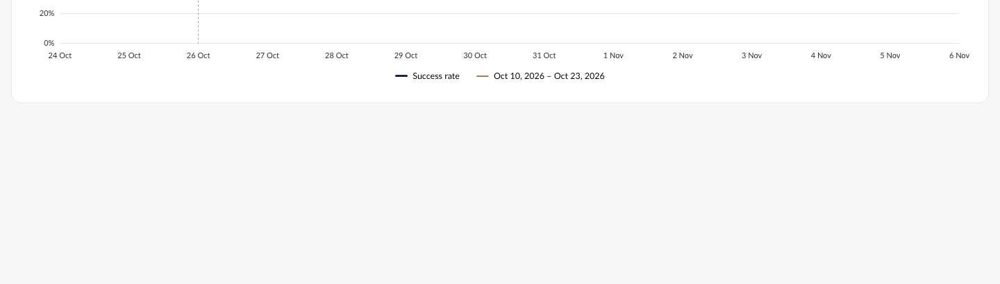
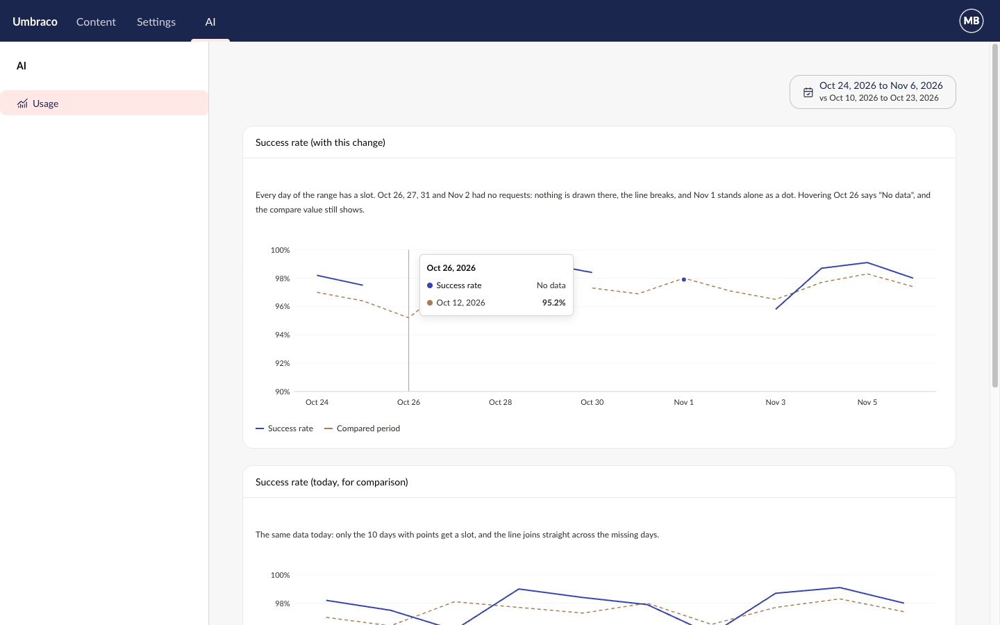
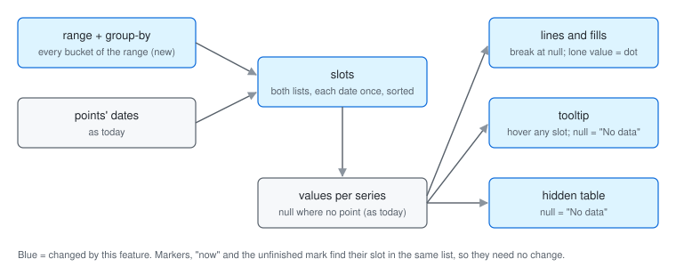

Closes #42 | [Plan folder](https://github.com/umbraco/Umbraco.Analytics.UI/tree/e2760d3a970098c667ccceb2a95a37677f62d2ce/docs/plans/empty-periods)

> [!IMPORTANT]
> **2 choices were made without you.** Please check each one.
>
> **1. Behavior: hovering an empty category in the category chart**\
> Plan said: `uaui-category-chart` isn't touched, apart from its hidden table.\
> Built: [hover is shared by both charts, so an empty category can now be hovered, and its tooltip lists every series with "No data" for an empty one](https://github.com/umbraco/Umbraco.Analytics.UI/blob/e2760d3a970098c667ccceb2a95a37677f62d2ce/src/Umbraco.Analytics.UI/Client/src/chart/category-chart.element.ts#L232). Before, hover jumped to the nearest category with a bar. Matches the time series chart and the hidden table.
>
> - **A. Keep "No data" rows** *(recommended)*
> - B. Show no tooltip on a category where every series is empty
>
> **2. Behavior: a week or month point not dated on its period's first day**\
> Plan said: points are not moved to their period's start.\
> Built: [such a point keeps its own slot beside the period's slot](https://github.com/umbraco/Umbraco.Analytics.UI/blob/e2760d3a970098c667ccceb2a95a37677f62d2ce/src/Umbraco.Analytics.UI/Client/src/chart/internal/chart-data.ts#L49), so at month level two slots can both read "Jan 2026". Products that build points with `uauiBucketsFor` never hit this.
>
> - **A. Keep it, and say in the docs to date points at the period's start** *(recommended)*
> - B. Move each point to its period's start (adds points up per period, which quietly adds up rates)

## Why the change

A rate or average chart can now show a period with no value as an empty slot, instead of a misleading 0 or a shrunken axis with a line drawn across the gap.

## What it looks like

**Where to find it:** Storybook › Components › Time series chart › Empty periods. Hover 26 Oct.

**Who can see it:** anyone viewing a product's chart that passes `range`. No access rules change.



| Mockup | Built |
|---|---|
|  |  |

## How to verify

1. Run `npm run storybook` in `src/Umbraco.Analytics.UI/Client` and open **Components › Time series chart › Empty periods**. The x-axis shows all 14 days, 24 Oct to 6 Nov.
2. Look at 26, 27 and 31 Oct and 2 Nov. Nothing is drawn there, and the line breaks instead of joining across.
3. Look at 1 Nov. It stands alone as a dot.
4. Hover 26 Oct. The tooltip shows "26 Oct 2026", "No data" for the series, and the compare value 95.2% from 12 Oct. The hover line sits on 26 Oct, with no dot on 25 Oct.
5. Switch Storybook to dark mode and repeat step 4. Same result, readable.
6. Open **Examples › Pages › Commerce**, pick the range 25 Dec 2025 to 7 Jan 2026 and the Cart conversion tile. All 14 days show, and nothing is drawn before 1 Jan (the store opened that day). Switch to Orders: those days show 0.
7. Open any other time series story with no `range`. It looks as it did before.

## Good to know

- No public API change: `api/analytics-ui.api.md` is untouched. The behaviour change is in the CHANGELOG under Changed.
- One new text key: `uauiAnalytics_chartNoData` ("No data").
- The Chart.js tooltip plugin is no longer turned on for our charts (our tooltip is HTML). It stays registered for products' own charts.
- The bundle is at 129.4 of its 130.0 KB gzip budget, so the next feature has 0.6 KB of room.
- Follow-ups not in this PR: dots on a series with an unfinished part have a thinner rim (already there before); after a data refresh, a hovered empty slot's tooltip keeps its old height until the mouse moves.

## Change outline

Where the x-axis slots come from now, and what reads the empty ones.



The files that changed, under `src/Umbraco.Analytics.UI/Client/src/`:

```diff
  chart/
    time-series-chart.element.ts     # passes range.to; a tooltip row for every shown series
    category-chart.element.ts        # a tooltip row for every shown series
    time-series-chart.story.ts       # Empty periods story; range and compare args
    internal/
      chart-data.ts                  # slots = range buckets + point dates
      chart-renderer.ts              # lines break at gaps; lone dots; hover from the x position
      chart-tooltip.element.ts       # a row with no value reads No data
      chart-data-table.element.ts    # an empty cell reads No data
      register.ts                    # comment: Tooltip is for products' charts
  lang/en.ts                         # chartNoData
+ chart/time-series-chart.empty-slots.test.ts
+ chart/time-series-chart.empty-lines.test.ts
+ chart/time-series-chart.empty-tooltip.test.ts
+ chart/time-series-chart.empty-marks.test.ts
+ examples/pages/commerce/commerce-analytics-page.empty-days.test.ts
  internal/perf/performance.test.ts  # a sparse 366-day range under the 100 ms budget
```

How the hover works now, in `chart-renderer.ts`:

```diff
  pointer moves over the chart
- Chart.js tooltip plugin: nearest drawn point (skips empty ones) → hovered index
+ our hover plugin (afterEvent): x position → slot index, even when the slot is empty
+   active elements = that slot's drawn points (so the hover dot follows the slot)
  hovered index → HTML tooltip and hover line
```

<details>
<summary>Checked and fine (6)</summary>

- A lone compare value also draws a dot, and a one-point chart with a compare line now shows a dot instead of nothing ([chart-renderer.ts](https://github.com/umbraco/Umbraco.Analytics.UI/blob/e2760d3a970098c667ccceb2a95a37677f62d2ce/src/Umbraco.Analytics.UI/Client/src/chart/internal/chart-renderer.ts#L410)).
- Dot border widths are pinned per chart to the widths Chart.js already used, so no existing pixel changed (all screenshot tests unchanged).
- On a slot with no current value but a compare point, the tooltip sits above the compare point; side padding picks the first or last slot; moving off the plot keeps the hover, as before.
- The tooltip's "No data" uses the tooltip's existing secondary text colour (about 7.5:1 on its dark surface).
- Empty rows rank last under "+N more", below negative values.
- The story's y-axis starts at 0 and its box keeps the shared "Pageviews over time" headline, both from the story file's shared render.

</details>

🤖 Generated with [Claude Code](https://claude.com/claude-code)
