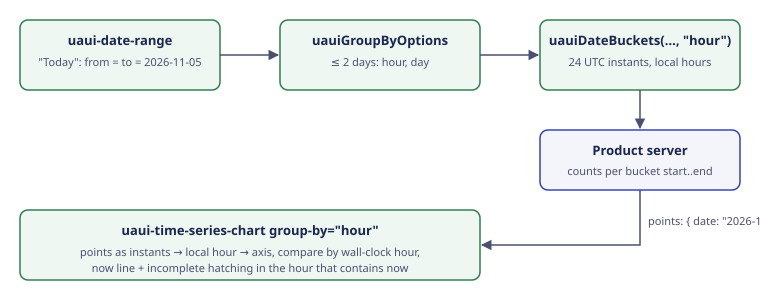

# Architecture: Hourly buckets

`group-by="hour"` makes the time series chart read each point's date as a moment, put it in the browser's local hour that contains it, and draw one bar per hour. Everything else (day, week, month) works as it does today.



## Decisions

- **The editor's time zone is the browser's**, the same one the date picker already uses for "today". No time zone setting on the chart.
- **`uauiDateBuckets` is renamed `uauiBucketsFor(range, groupBy)`** (type `UauiBucket`): it slices a range of time into the time series chart's slots, and an hour slot isn't a date. A plain rename, as nothing is released. With `"hour"`, each bucket's `start` is a UTC instant. Every bucket also gains an `end` (the next bucket's start), so a product sends `start..end` to its server without working it out.
- **Hour handling goes in a new `internal/date/hour-math.ts`**, not into `date-math.ts`, which keeps its "no time zone ever" rule.
- **Hours are UTC instants inside the chart** (`"2026-11-05T13:00:00.000Z"`), not local wall-clock text (`"2026-11-05T14:00"`). On the day clocks go back, 2 AM happens twice. Wall-clock text would merge those two hours into one bar. UTC instants still sort as plain text, so the rest of the chart (sorting, marker lookup, incomplete index) keeps working on strings. These keys are never shown: labels are formatted in local time with `Intl` ("2 PM", "Nov 5, 2026, 1 PM"; SPEC R26 to R29).
- **The bucket is the local hour that contains the instant**, worked out with `Date`'s local getters. A half-hour zone (India, +5:30) gets local hours too. A product that counts by UTC hour there gets bars that straddle two local hours. That is the product's call, and the spec says so.
- **Day, week and month don't change.** A date-time point is still cut to the day it starts with. Servers send `"2026-06-11T00:00:00Z"` for a day, and converting it would move it to the 10th west of UTC.
- **Compare lines up by wall-clock hour** (day × 24 + local hour, counted from the range's first day), not by elapsed hours. 2 PM sits under 2 PM yesterday, even when one of the days has 23 or 25 hours.
- **`now` replaces `today`** on the chart, and is dropped, not deprecated (nothing is released). One setting, so there's never "which one wins". The chart picks the word ("Today" or "Now") from `group-by`.
- **The "Hour" option rule lives in a helper, `uauiGroupByOptions(range)`**, not inside `uaui-group-by`. The group-by control has no range, and products already pass `options`.
- **The chart draws hourly for any range.** The 2-day limit is the helper's job, so a product can break it on purpose.
- **`today` and `yesterday` presets go in the existing built-in table** in `date-math.ts`, with their own translations, and stay out of `defaultPresets`.
- **The category chart doesn't change.** Its bars have no order in time (BRIEF, Not doing).

## What changes

**Client** (`src/Umbraco.Analytics.UI/Client/src`)

```text
internal/date/
  hour-math.ts              new: instant ↔ local hour, hour bucket start/end/offset, wall-clock offset
  date-math.ts              BucketUnit gains "hour" (routes to hour-math); today and yesterday presets
  format-date.ts            formats an hour key in the editor's culture
chart/
  types.ts                  UauiPoint.date and UauiMarker.date docs: date-times at hour level
  time-series-chart.element.ts   now replaces today; hour formats; Now wording
  internal/
    chart-data.ts           normalises dates per unit (cut to day, or to the local hour)
    marker-buckets.ts       hour buckets for markers and the now line
    incomplete-index.ts     hour buckets for incomplete-from
    now-plugin.ts           renamed from today-plugin.ts (TODAY_LABEL_ROOM becomes NOW_LABEL_ROOM)
    chart-renderer.ts       x ticks: one label every 3 or 6 hours, the day on each midnight
group-by/
  group-by.element.ts       UauiGroupBy gains "hour"; its label
date-helpers/
  date-helpers.ts           uauiDateBuckets renamed uauiBucketsFor, with "hour" and bucket end; uauiGroupByOptions
date-range/
  types.ts                  docs: today and yesterday are built-in ids
  date-range-modal.element.ts   labels for the two new presets
lang/en.ts                  new keys (SPEC, Rules)
examples/pages/            uauiDateBuckets calls renamed
examples/pages/ai/          Today preset, Hour option, hourly fake data
examples/pages/engage/, workflow/   today= becomes now=
```

- **Public API:** `api/analytics-ui.api.md` changes: `now` in, `today` out on the chart; `"hour"` in `UauiGroupBy`; `uauiDateBuckets` renamed `uauiBucketsFor` (and `UauiDateBucket` to `UauiBucket`), with `end`; `uauiGroupByOptions`; the two preset ids. Needs reviewer sign-off.
- **Stories and tests:** every story and test that sets the chart's `today` moves to `now`.

Not touched: `uaui-category-chart` (no time order), the date picker's own `today` (a plain date presets count from), the server side (this package has no API), Chart.js setup (no new plugins, no global changes; the now line is still a per-chart plugin).
