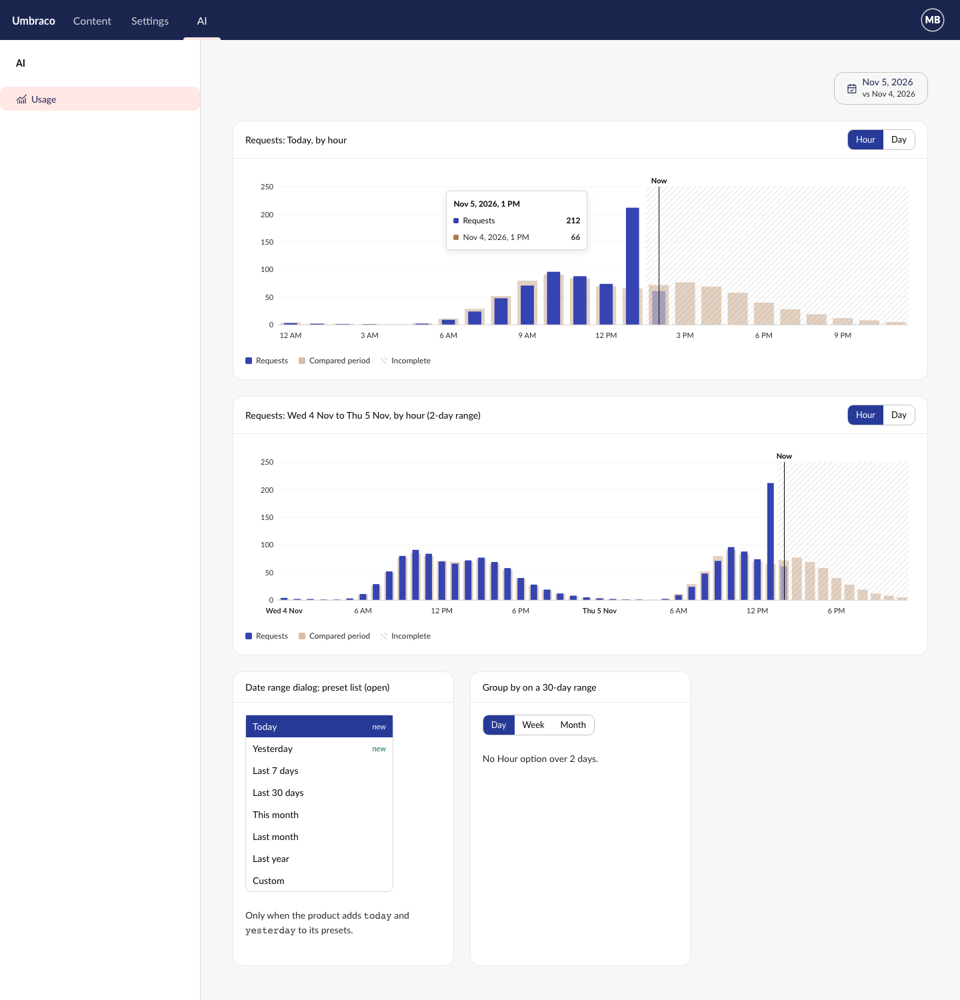
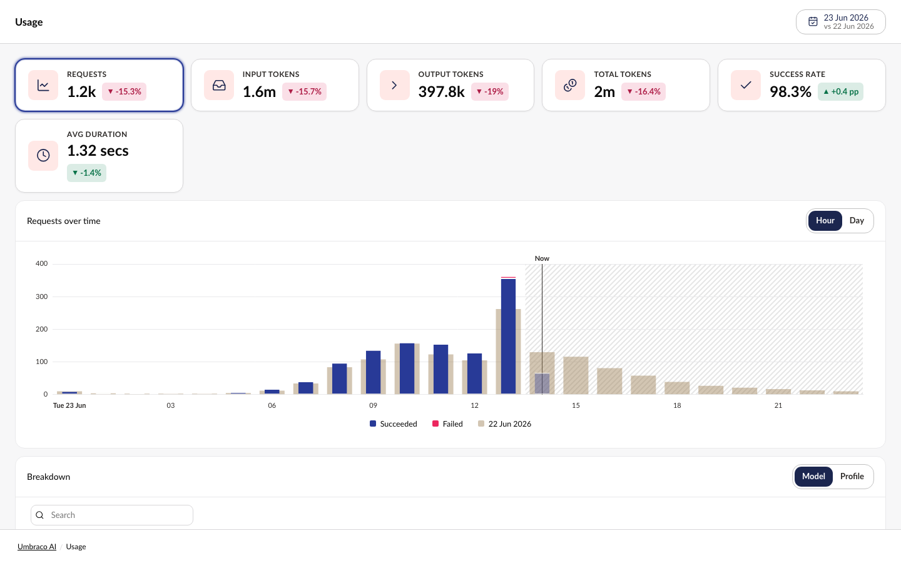
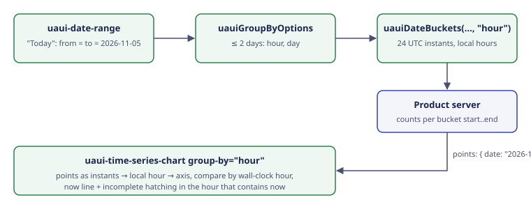

Closes #38 | [Plan folder](https://github.com/umbraco/Umbraco.Analytics.UI/tree/3f25c489cd1b5f53411f0334c00dcf9865947186/docs/plans/hourly-buckets)

> [!IMPORTANT]
> **5 choices were made without you.** Please check each one.
>
> **1. Behavior: the repeated hour when clocks go back**\
> Plan said: name the time zone on the repeated hour, on the axis too (SPEC R29).\
> Built: [the zone name shows in the tooltip and the hidden table only](https://github.com/umbraco/Umbraco.Analytics.UI/blob/3f25c489cd1b5f53411f0334c00dcf9865947186/src/Umbraco.Analytics.UI/Client/src/chart/time-series-chart.element.ts#L413). The repeated hour (2 AM in the EU, 1 AM in the US) never falls on a 3- or 6-hour axis label.
>
> - **A. Keep it in the tooltip and table only** *(recommended)*
> - B. Force an axis label on the repeated hour
>
> **2. UI: hour labels on narrow charts**\
> Plan said: a label every 3 or 6 hours (SPEC R28).\
> Built: [the step widens 3 → 6 → 12 → 24 hours as the chart narrows, allowing 72px per label](https://github.com/umbraco/Umbraco.Analytics.UI/blob/3f25c489cd1b5f53411f0334c00dcf9865947186/src/Umbraco.Analytics.UI/Client/src/chart/internal/hour-ticks.ts#L14), so labels never overlap. A fixed width keeps the bundle small, but a language with long labels could still crowd.
>
> - **A. Keep the fixed 72px** *(recommended)*
> - B. Measure each label's real width (costs bundle size; 1.1 KB is left)
>
> **3. Behavior: compare on the day clocks go back**\
> Plan said: compare lines up by wall-clock hour.\
> Built: [the two 2 AM bars share one wall-clock hour, so the compare value goes on the first 2 AM only](https://github.com/umbraco/Umbraco.Analytics.UI/blob/3f25c489cd1b5f53411f0334c00dcf9865947186/src/Umbraco.Analytics.UI/Client/src/chart/internal/chart-data.ts#L70), so it isn't counted twice.
>
> - **A. First 2 AM only** *(recommended)*
> - B. Show it on both bars
>
> **4. Behavior: today's KPI tiles in the AI example**\
> Plan said: nothing about the tiles.\
> Built: [on Today, the tiles compare the day so far with all of yesterday](https://github.com/umbraco/Umbraco.Analytics.UI/blob/3f25c489cd1b5f53411f0334c00dcf9865947186/src/Umbraco.Analytics.UI/Client/src/examples/pages/ai/ai-usage-page.element.ts#L248), so they show a drop mid-day. Example page only.
>
> - **A. Leave it; it's the example's server, not the library** *(recommended)*
> - B. Compare with yesterday up to the same time
>
> **5. UI: no "Incomplete" legend entry**\
> Plan said: the mockup shows an "Incomplete" item in the legend.\
> Built: the legend lists series only, as before; the hatch has no legend entry.
>
> - **A. Leave it; the hatch and the tooltip's "(now, incomplete)" carry it** *(recommended)*
> - B. Add an "Incomplete" legend entry
>
> | Mockup | Built |
> |---|---|
> |  |  |

## Why the change

Products could only chart a day, week or month per bar, so "today" or "yesterday" showed as one bar; this lets them show those days hour by hour.

## What it looks like

**Where to find it:** Storybook › Examples › Pages › Umbraco AI › Usage › date range › Today › Save › Hour. Also Components › Time Series Chart › By hour, and Today by hour, so far.

**Who can see it:** library components, so whoever can see the product screen that uses them.


## How to verify

1. Run Storybook and open Examples › Pages › Umbraco AI › Usage. The chart shows Day, Week and Month.
2. Open the date range, pick **Today** and save. The button shows one date, and the chart box now offers **Hour** and **Day**.
3. Pick **Hour**. You see one bar per hour, a **Now** line at 2:23 PM, and the hours after it hatched as unfinished.
4. Hover a bar. The tooltip names the hour ("23 Jun 2026, 13:00") and the compared hour from yesterday.
5. Pick **Day**. Today's bar is hatched as unfinished, with no Now line.
6. Pick **Last 30 days**. Hour disappears from the choices.
7. Open Components › Time Series Chart › By hour and narrow the window. Hour labels thin out instead of overlapping.

## Good to know

- **Breaking for teammates on prerelease builds:** `today` on `uaui-time-series-chart` is now `now`, and `uauiDateBuckets` / `UauiDateBucket` / `UauiDateBucketsOptions` are now `uauiBucketsFor` / `UauiBucket` / `UauiBucketsForOptions`. Nothing is released, so they are renamed, not deprecated.
- **The API report changed** (`api/analytics-ui.api.md`) and needs reviewer sign-off: the renames above, `"hour"` in `UauiGroupBy`, `uauiGroupByOptions`, and `end` on each bucket.
- **Bundle:** 128.9 of 130 KB gzip, so about 1.1 KB is left.
- **Time zone:** hours follow the browser's time zone. Tests pin it to Europe/Copenhagen so the clock-change days (29-03-2026, 25-10-2026) run the same everywhere.
- **Not in this PR:** the plan's ARCHITECTURE.md file list doesn't yet show `chart/internal/hour-ticks.ts` or the `marker-buckets.ts` → `bucket-lookup.ts` rename. The AI story's copyable imports header has older gaps, left for a separate fix.

## Change outline

How an hourly chart is drawn, from range to bars.



The public API, as the report changes:

```diff
  // uaui-time-series-chart
- today?: string
+ now?: string                        // a date, or a moment; "Now" by hour, "Today" otherwise
  groupBy: UauiGroupBy

- type UauiGroupBy = "day" | "week" | "month"
+ type UauiGroupBy = "hour" | "day" | "week" | "month"

- uauiDateBuckets(range, groupBy, options?): UauiDateBucket[]
+ uauiBucketsFor(range, groupBy, options?): UauiBucket[]
  // a bucket: { start, end, days }; `end` is new, hour buckets are UTC instants
+ uauiGroupByOptions(range): UauiGroupBy[]   // ["hour", "day"] for 2 days or less
+ date presets "today" and "yesterday" (opt-in, not in the default list)
  uauiFormatDateRange(range)          // one date for a one-day range
```

Files, grouped by job:

```diff
  src/
    internal/date/
+     hour-math.ts                    // local hours as UTC instants, clock-change safe
      date-math.ts                    // "hour" buckets; today/yesterday presets
      format-date.ts                  // hour labels
    date-helpers/date-helpers.ts      // uauiBucketsFor, uauiGroupByOptions
    chart/
      time-series-chart.element.ts    // `now`, hour tooltip and table
      internal/
+       hour-ticks.ts                 // labels every 3/6/12/24 hours by width
~       now-plugin.ts                 // was today-plugin.ts
~       bucket-lookup.ts              // was marker-buckets.ts
        chart-data.ts                 // compare by wall-clock hour
        incomplete-index.ts           // incomplete-from as a moment
    group-by/group-by.element.ts      // "Hour" option
    lang/en.ts                        // Hour, Now, Today, Yesterday keys
    examples/pages/ai/                // Today/Yesterday, Hour, now, unfinished marking
```

<details>
<summary>Checked and fine (5)</summary>

- `hourStart` subtracts local minutes instead of `setMinutes(0)`, so the second 2 AM isn't folded into the first: [hour-math.ts](https://github.com/umbraco/Umbraco.Analytics.UI/blob/3f25c489cd1b5f53411f0334c00dcf9865947186/src/Umbraco.Analytics.UI/Client/src/internal/date/hour-math.ts).
- `nextHour` is a flat +1 hour; only Lord Howe's 30-minute shift would differ.
- A malformed `now` or `incomplete-from` draws nothing by hour, and keeps the old cut-to-the-day fallback at day, week and month: [incomplete-index.ts](https://github.com/umbraco/Umbraco.Analytics.UI/blob/3f25c489cd1b5f53411f0334c00dcf9865947186/src/Umbraco.Analytics.UI/Client/src/chart/internal/incomplete-index.ts#L11).
- A clipped first or last week or month bucket reaches past the range; the `days` doc tells products to clip their query.
- The Forms example maps `hour` to its date dimension only to satisfy an exhaustive type; it never offers Hour.

</details>

🤖 Generated with [Claude Code](https://claude.com/claude-code)
