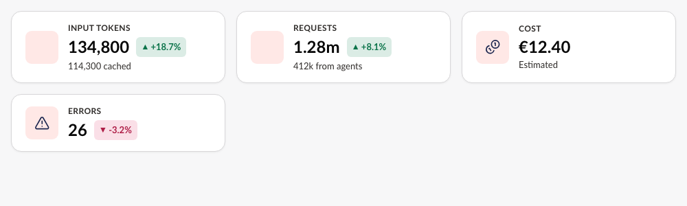
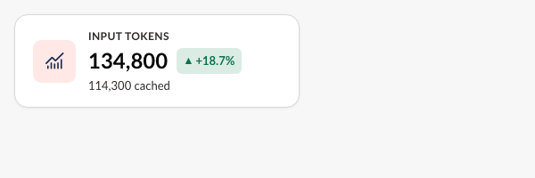
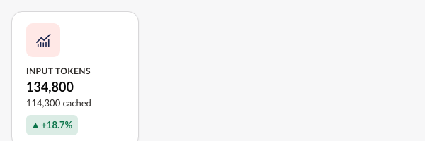
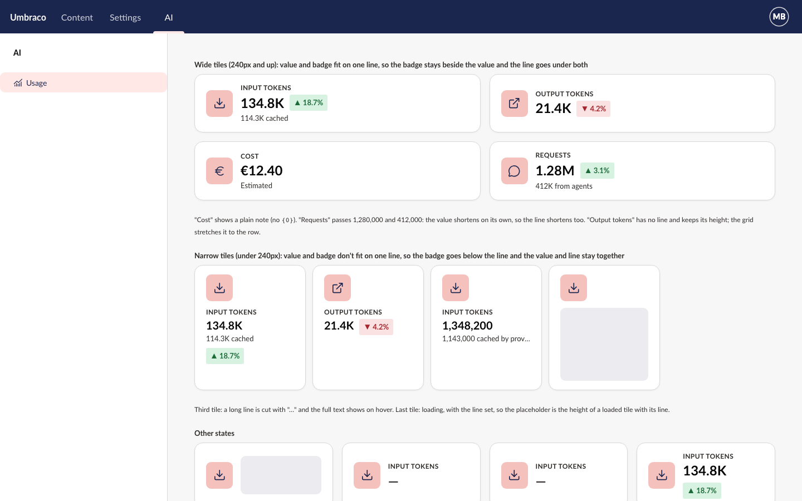
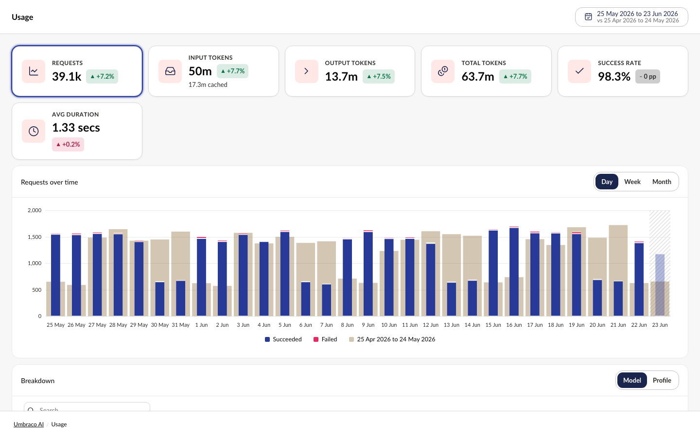

Closes #41 | [Plan folder](https://github.com/umbraco/Umbraco.Analytics.UI/blob/410a8973b39670215ab8a022d481100d69816231/docs/plans/kpi-tile-second-line)

> [!IMPORTANT]
> **5 choices were made without you.** Please check each one.
>
> **1. Behavior: no value, no line**\
> Plan said: nothing about a tile with a line but no value.\
> Built: [the line only shows when the tile shows a value](https://github.com/umbraco/Umbraco.Analytics.UI/blob/410a8973b39670215ab8a022d481100d69816231/src/Umbraco.Analytics.UI/Client/src/kpi-tile/kpi-tile.element.ts#L262) (new rule R18).
>
> - **A. Keep it: a part of nothing reads wrong** *(recommended)*
> - B. Show the line even when there's no value
>
> **2. Behavior: room for the line is kept when it's hidden**\
> Plan said: the loading placeholder makes room for the line when `detail` is set.\
> Built: [the room stays whenever `detail` is set](https://github.com/umbraco/Umbraco.Analytics.UI/blob/410a8973b39670215ab8a022d481100d69816231/src/Umbraco.Analytics.UI/Client/src/kpi-tile/kpi-tile.element.ts#L303), even on error, no data or no number. Such a wide tile is about 21px taller than one without `detail`.
>
> - **A. Keep it: no jump between loading and error** *(recommended)*
> - B. Reserve room only while the line is shown
>
> **3. Behavior: narrow tiles reserve the stacked height**\
> Plan said: a narrow tile's placeholder is the wrapped layout with the badge.\
> Built: [narrow tiles with a line always reserve value, line and badge stacked](https://github.com/umbraco/Umbraco.Analytics.UI/blob/410a8973b39670215ab8a022d481100d69816231/src/Umbraco.Analytics.UI/Client/src/kpi-tile/kpi-tile.element.ts#L610). A narrow tile whose badge fits beside the value has spare room below, as narrow tiles without a line already do.
>
> - **A. Keep it: no 28px jump when the badge wraps** *(recommended)*
> - B. Reserve the one-line height and let wrapped tiles grow on load
>
> **4. UI: the line's hover text**\
> Plan said: a long line is cut with "…", with the full text as its hover title.\
> Built: [the title is always set, to the shown text](https://github.com/umbraco/Umbraco.Analytics.UI/blob/410a8973b39670215ab8a022d481100d69816231/src/Umbraco.Analytics.UI/Client/src/internal/figure/figure-detail.element.ts#L38) ("412K from agents"). Chrome's accessibility tree gives a link tile the name "… 412,000 from agents" and no description. Not tried in NVDA or VoiceOver.
>
> - **A. Keep it, and check with a screen reader before release** *(recommended)*
> - B. Set the title only when the line is actually cut
>
> **5. Behavior: test widths for "doesn't fit"**\
> Plan said: the badge wraps in a 200px cell.\
> Built: [the tests use 180px](https://github.com/umbraco/Umbraco.Analytics.UI/blob/410a8973b39670215ab8a022d481100d69816231/src/Umbraco.Analytics.UI/Client/src/kpi-tile/kpi-tile.detail.test.ts). With Lato, "134,800" and "+18.7%" fit a 200px tile by 0.4px, so 200px was a brittle threshold. "Tops level" allows 1.5px, as the badge is centred on the value.
>
> - **A. Keep 180px** *(recommended)*
> - B. Keep 200px with a longer value in the test

## Why the change

Products can now show a small, formatted part of a KPI tile's total under its value, such as "114,300 cached", instead of cramming both into one string.

## What it looks like

**Where to find it:** Storybook › Components › KPI tile › With detail, Detail badge wrapped, Row with detail; and Examples › Pages › Umbraco AI › Usage.

**Who can see it:** anyone who sees the product's tile. The library adds no access rules.



| Badge beside the value | Badge wrapped below the line |
|---|---|
|  |  |

| Mockup | AI usage example |
|---|---|
|  |  |

## How to verify

1. In Storybook, open **KPI tile › With detail**. You see "134,800", the "+18.7%" badge beside it, and "114,300 cached" in smaller grey text below both.
2. Drag the canvas narrower until the badge no longer fits. The order becomes value, then "114,300 cached", then the badge, never badge between value and line.
3. Open **Detail, short number**. The value is "1.28M" and the line is "412K from agents". Hover "412K": the title is "412,000".
4. Open **Detail, loading** then **With detail**. The tile is the same height in both.
5. Open **Detail, error**. The tile shows a dash and no line.
6. Open **Examples › Pages › Umbraco AI › Usage**. The Input tokens tile shows "… cached" under its value.
7. Set `detail="{0} cached" detail-value="114300"` on a `uaui-kpi-tile` with a value. The line reads "114,300 cached".

## Good to know

- Public API: `uaui-kpi-tile` gains `detail`, `detail-value` and `detail-format`. The `api/analytics-ui.api.md` change needs your sign-off. Nothing is removed or changed.
- Products pass `detail` already translated (`this.localize.term(...)`). Only `{0}` is filled; `%0%` and `{1}` stay as typed.
- `uaui-stat` doesn't get the line yet. The new internal `uaui-figure-detail` and wrap controller are ready for it.

## Change outline

The tile's public surface grows by three properties.

```diff
 class UauiKpiTileElement extends UmbLitElement {
     value?: number | string;
     valueFormat?: Intl.NumberFormatOptions;
+    detail?: string;                          // "{0} cached", or a plain note
+    detailValue?: number;                     // fills {0}
+    detailFormat?: Intl.NumberFormatOptions;  // defaults to valueFormat
     ...
 }
```

New and changed files.

```text
src/Umbraco.Analytics.UI/Client/
├─ src/internal/format/figure.ts                 # figure() takes { compact } to shorten on request
├─ src/internal/figure/figure-detail.element.ts  # NEW: the line; splits the pattern at {0}
├─ src/internal/layout/wrap.controller.ts        # NEW: measures whether value and badge fit on one line
├─ src/kpi-tile/kpi-tile.element.ts              # three properties, grid layout, placeholder room
├─ src/kpi-tile/kpi-tile.story.ts                # 9 stories for the line
├─ src/examples/pages/ai/ai-usage-page.element.ts # Input tokens shows cached tokens
├─ .storybook/preview.ts                         # registers icon-chart-curve (older stories used it too)
├─ api/analytics-ui.api.md                       # the three properties
└─ CHANGELOG.md (repo root)                      # one line under Added
```

How the tile draws the line.

```text
render()
├─ format value                      → shown (with exact when shortened)
├─ format detailValue                → in detailFormat ?? valueFormat, short when the value is short
├─ hasFigureDetail(detail, figure)?  → and a value, and not error / no-data → draw the line
├─ <uaui-figure-detail>              → text parts + <uaui-figure-value> in each {0}
└─ UauiWrapController                → value + gap + badge > row? badge goes below the line
```

<details>
<summary>Checked and fine (5)</summary>

- `figure()`'s `compact: false` is the same as leaving it out; only `true` shortens.
- Whether a line exists is decided once, in `hasFigureDetail`, used by the tile and the element.
- A tile without `detail` has no observer, no new classes and today's 48px and 76px heights.
- The pattern is drawn as text, never HTML; a test covers markup in the pattern.
- The full suite passes (2,608 tests), with lint, build and `check:api` clean. A reviewer also ran the tile specs on Chromium, Firefox and WebKit.

</details>

🤖 Generated with [Claude Code](https://claude.com/claude-code)
