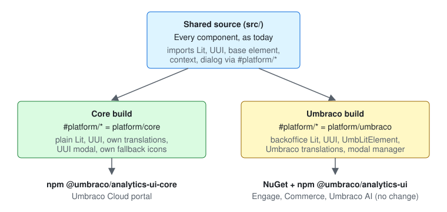

# Architecture: Standalone core package

One source, built twice. Components import the few Umbraco-only things (Lit, UUI, base element, context, dialog, icons, Chart.js) through small swap points under `#platform/*`. The core build points them at plain Lit and UUI; the Umbraco build points them at the backoffice, so the Umbraco package comes out the same as today.



> [!IMPORTANT]
> **6 guesses need your OK.**
>
> 1. The core npm package is called `@umbraco/analytics-ui-core`. `@umbraco/analytics-ui` keeps its name, since products and the import map already use it.\
>    *If not:* rename before the first core release; nothing else changes.
> 2. The core ships one ES module with `lit` and `@umbraco-ui/uui` as peer dependencies (the portal brings them) and `chart.js` as a normal dependency (installed for them, deduped by their bundler).\
>    *If not:* bundle Chart.js inside the core file, at the cost of a second copy if the portal also uses Chart.js.
> 3. The date fields in the date range dialog use `uui-input type="date"` in both builds, instead of the backoffice's `umb-input-date`, which only wraps it.\
>    *If not:* add a date field swap point, so the Umbraco build keeps `umb-input-date`.
> 4. `UmbTextStyles` is swapped for UUI's own `UUITextStyles` in both builds. They give the same text styles.\
>    *If not:* add it to the style swap point.
> 5. The full test suite runs on the core build. The Umbraco build runs the swap point tests plus a smoke set (each element renders, translations, the date range dialog, table context).\
>    *If not:* run the full suite on both builds, doubling test time on CI.
> 6. Storybook stays on the Umbraco build, as today, plus one docs page on using the core outside Umbraco.\
>    *If not:* a second Storybook on the core build.

## Decisions

- **Swap points chosen at build time**, not a runtime adapter that Umbraco plugs in. The Umbraco build then keeps `UmbLitElement`, `UmbContextToken` and Umbraco's own translations, so its public types and behaviour stay exactly as they are. A runtime adapter would have changed 26 public element types and the table context type for every product.
- **Swap points use Node's `imports` field (`#platform/lit`, ...)**, not relative imports. Vite, TypeScript, Vitest and Storybook all resolve it, and a lint rule can forbid the real packages anywhere else. Same idea as today's bare Chart.js specifier.
- **Components stay where they are.** Only `src/platform/` is new. Moving every folder under `src/core/` would touch every file for no gain.
- **Core translations work like Umbraco's**: keys, a dictionary per culture, the culture read from the nearest `lang` attribute, then `<html lang>`, then English. The same `en.ts` feeds both builds, so a key added once works in both.
- **The 8 Umbraco keys we reuse** (`general_close`, `buttons_save`, ...) get English fallbacks in the core build only. Inside Umbraco, the backoffice's own text still wins.
- **The date range dialog splits in two**: a plain content element shared by both builds, and a thin wrapper per build that opens it. Umbraco keeps the modal manager, so it stacks with other backoffice modals. The core opens it in UUI's `uui-modal-dialog`.
- **The core table context uses the community context protocol** (the `context-request` event that `@lit/context` speaks), our own few lines of code, no new dependency. Inside Umbraco it stays an `UmbContextToken`.
- **The core registers fallback icons** only for the icons our own elements draw (alert, search, calendar, ...), copied from the backoffice icon set. It answers only when no icon registry above it does, so a host's own registry always wins.
- **One version, one release.** Both packages take their version from `version.json` and ship from the same pipeline run.
- **Rejected: the core depends on `@umbraco-cms/backoffice`** for its base element and helpers. That package isn't made for use outside the backoffice and carries its own copies of Lit and UUI, so the portal would load them twice.

## What changes

**Client: swap points**

```text
src/Umbraco.Analytics.UI/Client/
├── package.json                     # "imports": #platform/* → core by default
├── src/platform/
│   ├── core/
│   │   ├── lit.ts                   # re-exports what we use from lit
│   │   ├── uui.ts                   # imports and registers the UUI elements we use
│   │   ├── chart.ts                 # re-exports chart.js
│   │   ├── base-element.ts          # UauiLitElement: LitElement + lang, dir, localize
│   │   ├── localization.ts          # term, date, number, lang; dictionary per culture
│   │   ├── context.ts               # context-request provider and consumer, simple state
│   │   ├── date-range-opener.ts     # opens the dialog in uui-modal-dialog
│   │   ├── icons.ts                 # fallback icons for our own elements
│   │   └── public.ts                # core-only exports (registerUauiTranslations, ...)
│   └── umbraco/
│       ├── lit.ts                   # re-exports @umbraco-cms/backoffice/external/lit
│       ├── uui.ts                   # re-exports @umbraco-cms/backoffice/external/uui
│       ├── chart.ts                 # @umbraco/analytics-ui/external/chart.js (import map)
│       ├── base-element.ts          # UauiLitElement = UmbLitElement
│       ├── context.ts               # UmbContextToken, UmbBasicState, UmbObjectState
│       ├── date-range-opener.ts     # modal manager + uaui-date-range-modal wrapper
│       ├── icons.ts                 # nothing: the backoffice has the icons
│       └── public.ts                # nothing extra
├── src/date-range/
│   ├── date-range-dialog.element.ts # was the modal element; now plain content
│   └── date-range.element.ts        # opens via #platform/date-range-opener
├── src/table/table-context.ts       # token and types from #platform/context
├── src/internal/localization/       # register.ts moves into platform/umbraco
├── vite.config.ts                   # Umbraco build: aliases #platform/* → umbraco
├── vite.config.core.ts              # core build → dist/core
├── api-extractor.core.json          # core API report
└── eslint.config.js                 # real lit, uui, chart.js, @umbraco-cms only in src/platform/
```

**Every component**

- Imports switch from `@umbraco-cms/backoffice/external/lit`, `.../lit-element` and `.../external/uui` to `#platform/lit`, `#platform/base-element` and `#platform/uui`. A search and replace, no behaviour change.
- `uauiFormatDateRange` and the delta helpers take our own `UauiLocalize` type (term, date, number, lang). `UmbLocalizationController` still fits it, so the Umbraco API doesn't change.

**Packaging and CI**

```text
src/Umbraco.Analytics.UI/Client/
├── package.json                     # build:core, check:api:core, pack:core
├── devops/publish/                  # packs both npm packages
├── devops/check-bundle-size.js      # budget for the core file too
api/
├── analytics-ui.api.md              # Umbraco API report: must not change
└── analytics-ui-core.api.md         # new core API report
azure-pipelines.yml                  # build, test and publish the core package
CLAUDE.md                            # import rules point at #platform/*
CHANGELOG.md                         # one changelog, core-only lines marked
```

Not touched: NuGet package and `umbraco-package.json` (same files, same import map), server code (none), Storybook setup (stays on the Umbraco build, see guess 6).
