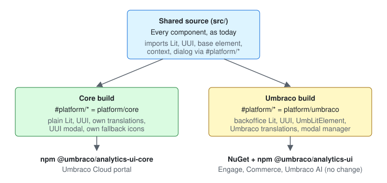

[Plan folder](https://github.com/umbraco/Umbraco.Analytics.UI/tree/21c035c2d1dfc2872188637bd4b5fded5fc63b2b/docs/plans/standalone-core)

> [!IMPORTANT]
> **3 choices were made without you.** Please check each one.
>
> **1. Behavior: what a core custom cell sees when it leaves a table**\
> Plan said: Nothing about it\
> Built: [the core's table context never calls a cell back with "no context" when the cell disconnects, and sends no `context-provider` event](https://github.com/umbraco/Umbraco.Analytics.UI/blob/21c035c2d1dfc2872188637bd4b5fded5fc63b2b/src/Umbraco.Analytics.UI/Client/src/platform/core/context.ts#L87). The backoffice does both.
>
> - **A. Keep it** *(recommended)*: the table always exists before its cells, and cells aren't moved between tables.
> - B. Match the backoffice: call back with "no context" on disconnect.
>
> **2. Behavior: a language change on a parent element**\
> Plan said: the culture comes from the nearest `lang`, then `<html lang>`, then English\
> Built: [changing `<html lang>` redraws every element, but changing a parent element's `lang` doesn't redraw its children](https://github.com/umbraco/Umbraco.Analytics.UI/blob/21c035c2d1dfc2872188637bd4b5fded5fc63b2b/src/Umbraco.Analytics.UI/Client/src/platform/core/localization.ts#L22). The guide says so.
>
> - **A. Keep it, documented** *(recommended)*
> - B. Watch `lang` on every ancestor: one watcher per element.
>
> **3. UI: the date range dialog's popup container in the core**\
> Plan said: open the dialog in UUI's `uui-modal-dialog`\
> Built: [the core adds its own `uui-modal-container` to the page body](https://github.com/umbraco/Umbraco.Analytics.UI/blob/21c035c2d1dfc2872188637bd4b5fded5fc63b2b/src/Umbraco.Analytics.UI/Client/src/platform/core/date-range-opener.ts#L10). If the portal already has a popup open, two dimmed backdrops stack.
>
> - **A. Keep it** *(recommended)*: simple, and the dialog still sits in the browser's top layer.
> - B. Reuse an existing `uui-modal-container` on the page when there is one.

## Why the change

The Umbraco Cloud portal wants our analytics components but isn't an Umbraco site, so this splits out `@umbraco/analytics-ui-core`, the same components on plain Lit and UUI, while Engage, Commerce and Umbraco AI keep using `@umbraco/analytics-ui` unchanged.

## How to verify

1. `cd src/Umbraco.Analytics.UI/Client && npm ci && npm run build`: both builds run. `wwwroot/` has the same 4 files as before, and `dist/core/analytics-ui-core.js` is new.
2. `npm run check:size`: the Umbraco total stays under 130 KB gzip, and the core file under 56 KB.
3. `npm run check:api`: `api/analytics-ui.api.md` passes with only two signed-off edits since `v19/dev`. `api/analytics-ui-core.api.md` is new and signed off.
4. `npm test`: the `core` project runs the whole suite with `@umbraco-cms/*` blocked. The `umbraco` project runs the backoffice integration specs and draws all 23 public elements in the Umbraco build.
5. In the pipeline run for this branch, the `npm` artifact holds both `umbraco-analytics-ui-<ver>.tgz` and `umbraco-analytics-ui-core-<ver>.tgz`, with the same version.
6. `npm run storybook` → Guides › Using outside Umbraco: the new guide for portal developers.
7. In a backoffice site, open any page with a date range and pick a period. It looks and behaves as before.

## Good to know

- Nothing changes for products. The Umbraco API report has two signed-off wording edits: `import type` → `import` for Lit's controller types, and a dropped `constructor();` on `UauiDateRangeElement`.
- The core's 6 fallback icons are Lucide's, and their licence ships in the built file. Please have the notice checked before the first core release.
- Both npm packages publish through Umbraco.Build's per-package publish step (umbraco/Umbraco.Build#15, merged).
- The core needs the same Lit and UUI versions as the CMS major (peers `lit ^3.3.1`, `@umbraco-ui/uui ^2.1.1`). The Cloud team aligns to that.

## Change outline

One source, built twice. Shared code imports the Umbraco-only parts through `#platform/*`, and each build points those at its own side.



The swap points: every one has an Umbraco and a core file.

```text
src/Umbraco.Analytics.UI/Client/src/platform/
├── localize.ts                    # UauiLocalize: the contract both sides meet
├── umbraco/                       # package.json "imports" → here (Umbraco build, tsc, Storybook)
│   ├── lit.ts, uui.ts, chart.ts   # re-export the backoffice's copies
│   ├── base-element.ts            # UauiLitElement = UmbLitElement
│   ├── context.ts                 # UmbContextToken, states, consumeContext/observe
│   └── date-range-opener.ts       # modal manager + uaui-date-range-modal
└── core/                          # vite.config.core.ts, tsconfig.core.json, core test project → here
    ├── lit.ts, uui.ts, chart.ts   # plain lit, @umbraco-ui/uui, chart.js
    ├── base-element.ts            # LitElement + lang, dir, localize
    ├── localization.ts            # term/date/number like the backoffice; registerUauiTranslations
    ├── context.ts                 # community context-request protocol
    ├── date-range-opener.ts       # uui-modal-dialog
    ├── icons.ts                   # 6 fallback icons (Lucide)
    └── index.ts                   # the core entry: src/index.ts + public.ts
```

How it builds and ships.

```diff
  npm run build
    tsc -p tsconfig.app.json                  # Umbraco side
+   tsc -p tsconfig.core.json                 # core side, @umbraco-cms/* blocked
    vite build                                # → wwwroot (unchanged)
+   vite build -c vite.config.core.ts         # → dist/core/analytics-ui-core.js (lit, uui, chart.js external)
    api-extractor                             # api/analytics-ui.api.md
+   api-extractor -c core/api-extractor.json  # api/analytics-ui-core.api.md + types/core rollup
  npm run ci:pack-client
    pack:api                                  # @umbraco/analytics-ui (types)
+   pack:core                                 # @umbraco/analytics-ui-core, version from version.json
```

<details>
<summary>Checked and fine (7)</summary>

- New dev-only packages `lit` ^3.3.3 and `@umbraco-ui/uui` ^2.1.1 match what CMS 19 resolves.
- The Umbraco build registers one new internal tag, `uaui-date-range-dialog`, and no longer imports the backoffice's `/components` and `/style`.
- The core's translation store is per package copy. Two copies on one page aren't supported anyway (same element names).
- `@linkcode` is defined in `tsdoc.json`, because Lit's doc comments use it.
- The core test setup removes leftover popups after each test.
- Build specs build into temporary folders, once per run, and never touch `dist/core` or `wwwroot`.
- Example pages and docs keep the real Umbraco imports, since they show product code.

</details>

🤖 Generated with [Claude Code](https://claude.com/claude-code)
