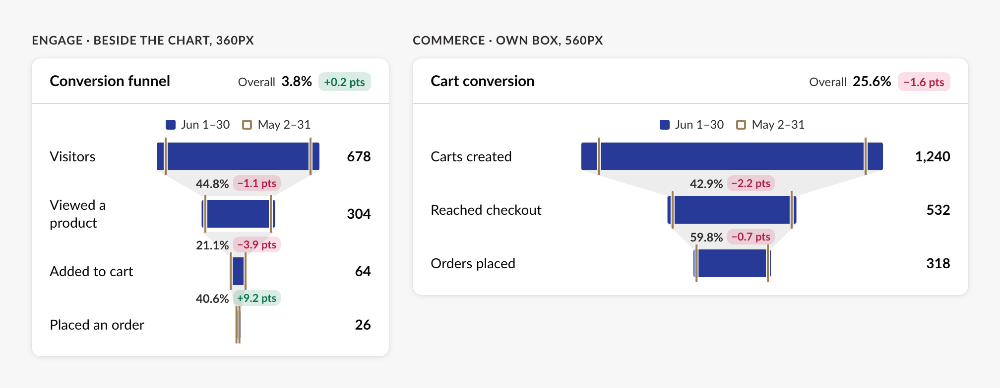
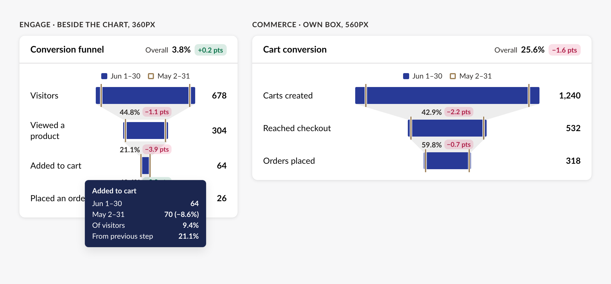

# Spec

## Management API surface

None. The package has no server code. Products call their own APIs and pass data in.

## Frontend components

All elements live in `src/Umbraco.Analytics.UI/Client/src/<name>/` and are exported from `@umbraco/analytics-ui`. Every element:

- extends `UmbLitElement` and localizes every visible string, `aria-label` and placeholder
- uses `--uui-*` tokens and reads colours through the `--uaui-color-*` read tokens (ARCHITECTURE.md decision 6), and reads correctly in the light, dark and high-contrast themes
- raises events as `CustomEvent`s that bubble but are not `composed`, like UUI's `change`, with the payload in `detail` (an exported `Uaui…Detail` type). The exception is `retry` (`uaui-error-state` and the chart and table that re-raise it): a plain `Event` that bubbles, is not `composed` and has no detail. The KPI tile's `selected`/`deselected` are bubbling, cancelable, non-composed `CustomEvent`s with `detail` `{}`, like `UUISelectableEvent`
- passes an axe audit in its tests and in every Storybook story
- takes corner radius from `--uui-border-radius-*` tokens, so it follows the v18+ rounded backoffice

Screenshots are from the Phase 1 design ([`docs/design/phase-1`](../../design/phase-1/README.md)). They're the visual contract for layout and content. Where they show the older square 3px corners (panes, cards, pills), the v18+ rounded tokens win.

### Shared types

```ts
type UauiPoint = { date: string; value: number };              // date: ISO "2026-06-11"
type UauiSeries = { id: string; label: string; points: UauiPoint[]; color?: UauiColorSlot }; // color: palette slot, defaults to the series' position
type UauiMarker = { id: string; date: string; title: string; description?: string };
type UauiColorSlot = 1 | 2 | 3 | 4;                           // --uaui-series-1 to --uaui-series-4
type UauiGroupBy = "day" | "week" | "month";
type UauiChartKind = "line" | "area" | "bar" | "stacked-bar";
type UauiDateRange = { from: string; to: string; preset?: string };
type UauiCompare = { mode: "previous-period" | "previous-year" | "custom"; from: string; to: string };
type UauiDateSpan = { from: string; to: string };              // any range; a UauiDateRange or UauiCompare fits
type UauiDateBucket = { start: string; days: string[] };       // start: where the chart plots the bucket; days: only the days inside the range
type UauiFunnelStep = { id: string; label: string; value: number }; // one funnel step; compare steps match by id

// Event details
type UauiGroupByChangeDetail = { value: UauiGroupBy };
type UauiDateRangeChangeDetail = { value: UauiDateRange; compare?: UauiCompare };
type UauiMarkerClickDetail = { id: string };
type UauiToggleGroupChangeDetail = { value: string };
type UauiSearchDetail = { query: string };
```

**Date helpers** (public functions in `src/date-helpers/`, for products that use them without the picker; weeks start on Monday unless `weekStart` says otherwise; nothing reads the locale for you):

- `uauiPreviousPeriod(range)`: the same number of days straight before `range` (`UauiDateSpan`, or `undefined` for an invalid range).
- `uauiPreviousYear(range)`: the same dates one year earlier (`UauiDateSpan` or `undefined`).
- `uauiCompareFor(mode, range)`: a full `UauiCompare` for `previous-period` or `previous-year`. `custom` and invalid ranges give `undefined`.
- `uauiDaysIn(range)`: every day in the range, both ends included.
- `uauiDateBuckets(range, groupBy, { weekStart })`: `UauiDateBucket[]`. `start` is the day, the first day of the week or the 1st of the month. `days` holds only days inside the range. `weekStart` (`UauiWeekStart`, optional) is an ISO weekday number, 1 (Monday, the default) to 7 (Sunday), the numbering of `Intl.Locale.getWeekInfo().firstDay`, so a product can pass the editor's culture straight through. A value that isn't a whole number from 1 to 7 is read as Monday, never thrown on.
- `uauiFormatDateRange(localize, range, { showYear })`: the range as "May 25, 2026 to Jun 23, 2026", the label the date range button and the chart's `compare-label` use. It takes `this.localize`, so it follows the user's culture and the translated "{0} to {1}" term. `showYear: false` leaves the year off.

### 1. Panes: `uui-box`, not a new element


Products wrap each chart and table in the backoffice's own `uui-box`. It already has everything the design's pane needs, and it picks up the v18+ rounded corners by itself:

- the headline (property or `headline` slot, where the icon goes as a `uui-icon`)
- `header-actions` for the group-by, notes and date range controls
- the divider under the header
- `--uui-box-default-padding: 0` for every chart and table, so they run edge to edge. Each pads its own content, and the reload loading bar then sits directly under the header divider, full width

Storybook gets a "Pane" story showing this recipe, a chart and a table in one `uui-box`, so every product builds it the same way. There's no divider between a chart and a table that follows it, which the recipe shows.

### 2. `uaui-kpi-tile`: KPI tile


- Properties:
  - `label`
  - `value` (pre-formatted string)
  - `icon`
  - `delta`, `delta-unit` and `lower-is-better` (passed to `uaui-delta-badge`). Or `current` and `previous` in place of `delta`, and the badge works out the change; `delta` wins.
  - `selectable`, `selected`
  - `no-data`: the metric has no data for the period (see below)
  - `error`: the data could not be loaded (see below)
- One style only: a card with the icon in a pink square, as in every Phase 1 screenshot.
- Not used for table totals ("TOTAL PAGEVIEWS 272 +8.4%"). Those are a label and a number, which the product slots into the table's column toolbar (`toolbar-<column key>`, §7), using `uaui-table-total` for the label, number and change.
- **Selectable:** follows UUI's `SelectableMixin` (as `uui-card` uses), so product code reads the same as for UUI cards. This lets a row of tiles switch which metric a chart shows, like Engage's `AnStatPanes`.
  - When `selectable`, the tile is a toggle button with `aria-pressed` (UUI cards don't expose their state to screen readers; this does).
  - Clicking, Enter or Space on an unselected tile raises a cancelable `selected` event, then sets `selected` unless the event was cancelled.
  - On a selected tile it raises a cancelable `deselected` event, then clears `selected`, unless the event was cancelled or `deselectable` is false (default true). A product keeping exactly one tile selected sets `deselectable` false and clears the others on `selected`.
  - A selected tile with `deselectable` false raises nothing when pressed. This departs from `uui-card`, which raises `selected` again.
  - Look matches `uui-card`: a 2px `--uui-color-selected` border just outside the card with a soft glow when selected; the same border at 33% on hover when not selected, 80% on hover when selected; focus is a separate `--uui-color-focus` outline.
- **No data:** `no-data` shows a dash (hidden from screen readers) with the hidden text "No data for this period" (`uauiAnalytics_kpiNoData`; the shared empty-state "No data yet" reads oddly for a past period) and no change badge. The tile keeps its height and stays selectable. With `loading` it keeps the dash and is busy. It is a boolean on purpose: an unset `value` means "not loaded yet", and a formatted "0" is a real value.
- **Error:** `error` shows the label, a dash and no badge, with the hidden text "Something went wrong". The tile has no Retry button (a row of tiles would each show one) and stays selectable. `error` wins over `no-data` and `loading`, and the tile is not busy.
- Tiles in one row keep the same height, even when a label wraps. The badge sits below the value when the tile is too narrow to fit both on one line (as in `kpi-size.png`).

### 3. `uaui-delta-badge`: change badge (exists, needs restyling)

- Restyle to the design's tinted pill: a green or red tint behind the text, 13px bold, `4px 8px` padding. Flat values use a neutral tint.
- Add `size`: `"md"` (default) | `"sm"` (for table cells).
- Keep the current behaviour: signed number, `percent` or `points`, `lower-is-better`, rounding to `max-decimals`. Number formatting moves to `this.localize.number`.
- Add `current` and `previous`: the badge works out the change itself when `value` isn't set. Percent change against the size of `previous` (unknown when `previous` is 0, so nothing is drawn), or with `unit="points"` the difference between two percentages. `value` wins when both are given. `uaui-table-compare-badge` passes its two numbers through instead of doing the maths.

### 4. `uaui-time-series-chart`


- Properties:
  - `kind` (`UauiChartKind`)
  - `series` (`UauiSeries[]`)
  - `compare-series` (`UauiSeries[]`, matched to `series` by `id`)
  - `compare-label`
  - `markers` (`UauiMarker[]`)
  - `group-by` (`UauiGroupBy`, sets the x-axis label format)
  - `week-start` (`UauiWeekStart`, 1 to 7, default 1 = Monday): the day weeks start on when `group-by` is `week`. Decides which week a compare point sits in, so give it the same value as `uauiDateBuckets`. Anything but a whole number from 1 to 7 is read as Monday
  - `value-format` (`Intl.NumberFormatOptions`)
  - `range` (`UauiDateRange`), `compare` (`UauiCompare`): the period starts, to align compare points (see Comparison)
  - `lower-is-better` (boolean, reflected, default false): see Lower is better
  - `loading`
  - `empty-headline`, `empty-description`
  - `error`, `error-headline`, `error-description`, `retryable`: see Error
- **Error:** `error` replaces the plot, legend and hidden table with `uaui-error-state` (§8), passing on `error-headline`, `error-description` and `retryable`. The canvas stays in the DOM, hidden, so a retry doesn't rebuild the chart. The chart re-raises the state's `retry` from its own host. Precedence is error, then loading, then empty: an element in error is not `aria-busy` and shows no skeleton or loading bar. `error` is a plain property, so the product decides what an error is.
- **Comparison, by kind:**
  - `line` and `area`: a dashed `--uaui-compare` line, with the gap between the two lines shaded.
  - `bar` and `stacked-bar`: the comparison total is drawn as a bar behind each date's bars. For bar kinds, all compare series are summed per date and aligned by bucket offset like any compare series (no `id` matching), and the current total for that date is shown in the tooltip and hidden table whenever it's compared against two or more series.
  - Comparison points line up by bucket offset, not by date: the Nth day, week or month (per `group-by`) from the compare range start sits under the Nth from the current range start. The chart takes optional `range` (`UauiDateRange`) and `compare` (`UauiCompare`) for those starts, as `uaui-date-range` emits them; without them each side starts at its first point, which misaligns when sparse data omits the first buckets. A shorter compare leaves trailing dates empty. Points on the same date add up (series, compare and compare total alike).
- **Lower is better:** `lower-is-better` is for a metric where a fall is good (refund rate, bounce rate, average duration). It flips the gap shading (below the compare line uses `--uaui-gap-positive`, above uses `--uaui-gap-negative`; those tokens mean good and bad) and is passed to every change badge in the tooltip, rows and bar total alike. One chart-level flag, since one chart shows one metric and its series are breakdowns of it.
- **Tooltip:** hovering a point shows a dark tooltip with the date, each series' value and, when comparing, the comparison value and a delta.
- **Markers:** each marker shows as a dot on the x-axis, with a dashed line up the chart.
  - Hovering or focusing a dot shows its title and description.
  - Clicking or pressing Enter raises `marker-click` with `{ id }` (`UauiMarkerClickDetail`).
  - Dots are keyboard-focusable, in date order.
- **Legend:** one entry per series, plus the comparison range when comparing. A single series with no comparison has no legend, as in the design.
- **Height:** the plot height comes from the public CSS property `--uaui-chart-height` (default 260px). The loading skeleton uses the same value.
- **Padding:** the chart pads its own content with the public CSS property `--uaui-chart-padding` (default the design's 12px 24px 28px). The reload loading bar sits outside that padding, at the element's top edge and full width.
- **Other rules:**
  - The y-axis starts at 0, with about 5 ticks on round numbers.
  - X-axis labels rotate when crowded and never overlap.
  - Bar kinds have no smoothing.
- **Accessibility:** a visually hidden table holds the same data, for screen readers.

### 5. `uaui-group-by` and `uaui-toggle-group`: Day / Week / Month switch

**`uaui-toggle-group`** (public) is a toggle group: a row of options with exactly one selected at a time (single choice, never several), built as a radio group. UUI has no such control (`uui-button-group` has no selection, `uui-tabs` switches panels, `uui-radio-group` draws radio circles).

- Properties: `value` (the selected option's `value`), `options` (`{ value, label }[]`) and `label` (the group's accessible name, not shown).
- Arrow keys move the selection and focus to the next or previous option, wrapping at the ends. Only the selected option is in the tab order (the first when `value` matches no option).
- Clicking another option sets `value` and raises `change` with `{ value }` (`UauiToggleGroupChangeDetail`). Clicking the selected option raises nothing.
- Put it in a `uui-box`'s `header-actions` slot.

**`uaui-group-by`** is `uaui-toggle-group` with the day, week and month options.

- Properties: `value` (`UauiGroupBy`), `options` (defaults to all three).
- It re-raises its own `change` with `{ value }` (`UauiGroupByChangeDetail`).

### 6. `uaui-date-range`: date range picker


- Properties:
  - `value` (`UauiDateRange`)
  - `compare` (`UauiCompare | undefined`)
  - `presets` (defaults to last 7 days, last 30 days, last month, last year and custom; a product can pass its own, such as AI's last 24 hours)
  - `allow-compare` (default true). A plain boolean attribute, like `deselectable` and UUI's: it can't say false, so turn it off with the property, `.allowCompare=${false}`
  - `max-date` (default today)
  - `today` (an ISO date). Presets, the default `value` and the default `max-date` count from it. Unset uses the clock, and text that isn't a real date is ignored, so a typo can't break the picker. `max-date` still wins for the latest allowed date. A `value` the product sets stays as given. Examples set it so presets match their fixed data.
- With a comparison on, the button stays as tall as `uaui-group-by` (40px) and shows two lines: the range on line 1, "vs Apr 25, 2026 to May 24, 2026" on line 2, small and in a lighter grey (text-alt mixed 70% with the surface: 5.3:1 light and high contrast, 6.3:1 dark). Line 2 always shows the year. With a comparison, line 1 is 1px smaller than the default text size. The button's accessible name is the purpose plus both lines as shown. Both lines are cut with an ellipsis in a narrow header. Without a comparison the button is unchanged.
- The button opens `uaui-date-range-modal` through the backoffice modal manager.
  - **Save** closes the dialog and raises `change` with `{ value, compare }` (`UauiDateRangeChangeDetail`).
  - **Close** discards the edits.
- **Presets:** choosing one fills both dates. Editing either date switches the preset to "Custom".
- **Compare:** turning it on shows the compare mode. "Previous period" and "Previous year" fill the comparison dates. "Custom" shows two more date fields.
- **The mistake:** an end date before the start, or a date after `max-date`, shows an inline error under the field and disables Save.

### 7. `uaui-data-table`


- Properties:
  - `columns`: `{ key, label, elementName?, meta?, valueFormat?, align?, width?, sortable?, sortAs?, searchable? }[]`. `elementName` picks the cell (default the text cell; constants in `UAUI_TABLE_CELL`). `valueFormat` is per column (`Intl.NumberFormatOptions`). `width` is a CSS width, as in the CMS `umb-table`. `meta` holds what cells read: `hrefKey`, `color` (1 to 4, a share bar's palette slot) and `lowerIsBetter` (for compare badges).
  - `rows`: `Record<string, unknown>[]`
  - `compare-rows`, matched to `rows` by the `row-key` property (the key in each row that identifies it). When several compare rows share a key, the last wins
  - `stats`: `{ [columnKey]: { total, max } }` (`UauiTableStatsInput`) across every page, for share percents and bar scales in `server` mode. An entry may give just `total` or just `max` (`UauiTableStatsInput`, a partial `UauiTableColumnStats`): each field missing, or the whole entry, falls back to the sum or largest value of the rows the table holds. `UAUI_TABLE_CONTEXT` always gives cells both fields worked out
  - `sort` (`{ key, direction }`)
  - `mode` (`"client"` | `"server"`)
  - `page`, `page-size`, `total-rows` (the row count across every page, `server` mode)
  - `query` (the search text; the table sets it from a `uaui-search-field` in the `toolbar`, `toolbar-start` or a `toolbar-<key>` slot)
  - `clickable-rows` (makes rows openable and raises `row-click`)
  - `loading`
  - `empty-headline`, `empty-description`
  - `error`, `error-headline`, `error-description`, `retryable`
- **Error:** `error` shows `uaui-error-state` (§8) in place of the rows, passing on `error-headline`, `error-description` and `retryable`. The header stays. The rows, column toolbar, skeleton, "No results" and pager go. The table re-raises the state's `retry` from its own host. Precedence is error, then loading, then empty: the table in error is not `aria-busy` and shows no skeleton or loading bar. `error` is a plain property, so the product decides what an error is.
- **Loading:** cells take an optional `loading` flag and draw their own placeholder, so loading rows match loaded rows. A cell without `loading` gets a generic placeholder.
- **Cells are elements**, as in the CMS `umb-table`: each gets `column`, `item` (the row) and `value`. A column names its cell with `elementName` (default the text cell); the package ships ready-made cells (`uaui-share-cell` and others, with exported name constants). Columns have no `type`: alignment is `align`, sorting is `sortAs` (number, text or a compare function). Cells that need table-wide data (column total and max, compare rows) read it from the table's context, so the table doesn't special-case any cell.
- Slots: the toolbar is one idea, filled full width or column by column. `toolbar` is the full-width slot, for a search box alone (or any free layout above the header). `toolbar-start` is the first column's cell and `toolbar-<column key>` is any column's cell, for a search in the first column and a total over each number column. `footer` is left of the pager.
- **Column toolbar:** content slotted as `toolbar-<column key>` sits in that column's cell, so it lines up with the header and the numbers below and takes the column's `align`. `toolbar-start` is always the first column's cell, whatever its key, so every product writes `<uaui-search-field slot="toolbar-start">`; if it and `toolbar-<first column key>` are both filled, both show in that cell, `toolbar-start` first. A column keyed `start` makes the name ambiguous, so `toolbar-start` always means the first column's cell and a column keyed `start` shares it (it has no slot of its own, and the slot is drawn once). It is a row of the table, above the column headings (below the `toolbar`, if any), and is not sorted, searched or paged. It stays hidden while nothing is slotted for a column the table has (or in `toolbar-start`). Content that arrives later shows it. A slot for an unknown column draws nothing. In `error` it is hidden.
- **`uaui-table-total`** (public) is the piece for a total in the column toolbar: a small uppercase `label`, a `value` string shown as given, and a `uaui-delta-badge` (size `sm`) from `delta`, or from `current` and `previous` with `delta-unit` and `lower-is-better`, the same names and rules as `uaui-kpi-tile`. It takes the `text-align` of its cell. A `uaui-search-field` in `toolbar-start` or a `toolbar-<column key>` slot drives the table like one in `toolbar`.
- **Padding:** the cells pad themselves. The `toolbar` slot pads itself with the public CSS property `--uaui-table-padding` (default `12px 24px`), only when something is slotted. The reload loading bar sits outside it at the element's top edge, full width, so put the table in a `uui-box` with `--uui-box-default-padding: 0`.
- **Share cells (`UAUI_TABLE_CELL.share`):** show the value, its percent of the column total, and a thin bar scaled to the column's largest value.
  - The first share column uses `--uaui-series-1`, the second `--uaui-series-2`.
  - When comparing, a compare badge sits after the value.
- **Compare badges:** number, percent and share cells show a change badge when the table has a compare row for the row. `uaui-table-compare-badge` is the public piece behind them, and a product's own cell uses it with `column`, `item` and `value`. A column's `meta.lowerIsBetter` makes a fall positive.
- **Link cells (`UAUI_TABLE_CELL.link`):** render an anchor. The row's `href` comes from the column's `meta.hrefKey`.
- **Sorting:** clicking a sortable header toggles the direction and raises `sort-change`. In `client` mode the table also sorts itself.
- **Paging:** the footer is an internal compact pager (`uaui-compact-pager`, no table wording; its text comes from the `pager*` keys, so a product rewords it with its own localization). It has "Per page" (10, 25, 50, 100) and "1–10 of 272". It raises `page-change` with `{ page, pageSize }`, and in `client` mode it also pages itself. The footer is hidden when the rows fit on one page at the smallest page size the editor could need (row count ≤ the smaller of the current page size and 10), so a table at 50 rows per page can still go back to 10.
- **Search:** The package exports `uaui-search-field` for the table's toolbar slots. It raises `search` with `{ query }`, 300ms after typing stops. In `client` mode the table filters rows on columns marked `searchable`; if none are marked, on every column's text.
- **`UauiTableServerController`** (public) runs the server side of a `server` table, so a page doesn't write the wiring again. It is a Lit `ReactiveController` that works on any host: create it on the page, attach it with `${ref(controller.attach)}`, and don't bind the properties it sets.
  - **Options:** `load(state, signal)` (required, returns the rows and any fields of your own), `sort`, `page` (default 1), `pageSize` (default 10), `query`, `onError(error)` and `retryable` (default true).
  - **Sets on the table:** `mode="server"`, `sort`, `page`, `pageSize`, `query`, `rows`, `compareRows`, `totalRows`, `stats`, `loading`, `error` and `retryable`. `result` hands back the last good answer with your own fields.
  - **When it loads:** when the host connects, and on the table's `sort-change`, `page-change` and `search`. A sort or search goes back to page 1, and a search with the same query loads nothing. `reload({ resetPage })` is for changes it can't see, such as the date range.
  - **Newer wins:** a newer request aborts the one before it (the `AbortSignal` passed to `load`), and a late answer is also dropped by a request counter, because a loader may ignore the signal. An aborted request is not an error.
  - **Failure:** any other rejection sets `error` (on the controller and the table), keeps the old rows in `result`, clears `loading` and calls `onError`. The table's `retry` calls `reload()`. The error clears when the next request starts, so a retry shows the skeleton or the old rows under a loading bar.
  - **Disconnected host:** it starts nothing (`reload` and table events do nothing). The host leaving aborts the request, and the state is loaded as it is on reconnect.
- **Rows:** a row is clickable only when the product sets `clickable-rows` (an element can't tell whether `row-click` has a listener). Then it's keyboard-reachable (Enter or Space) and raises `row-click` with `{ row }`. Clicks on links and buttons inside a row stay with them.

### 8. `uaui-empty-state`, `uaui-error-state` and loading

- **`uaui-empty-state`:** properties `headline`, `description`, `icon`. The data elements use it when they have no data. A product can also place it on its own.
- **`uaui-error-state`:** a separate public element (not a variant of the empty state: an error needs a role, a Retry action and an event). Same layout and look as the empty state, with an alert icon.
  - Properties: `headline`, `description`, `icon` and `retryable` (default false).
  - Without `headline` or `description` it shows "Something went wrong" and "The data could not be loaded." An empty string hides that line.
  - `retryable` shows a Retry button that raises `retry` (a plain `Event`, bubbling, not composed, no detail). Without it there is no button.
  - The text is announced when it appears (`role="alert"`).
  - The chart and table show it when `error` is set. The KPI tile shows a dash instead.
- **Loading:** each data element (chart, table, KPI tile) has a `loading` property.
  - On first load it shows a skeleton the same size as the loaded element, so the page doesn't jump.
  - While reloading with data already shown, the old data stays visible under a thin loading bar at the top.

### 9. Theme and localization

- Products override the `--uaui-*` colour names on any parent element. Elements read resolved `--uaui-color-*` copies (ARCHITECTURE.md decision 6). Default colours have a light and a dark shade, each at least 3:1 against the surface.
- Ships `en` translations for its own strings under `uauiAnalytics_*`. Generic verbs reuse Umbraco's keys (`buttons_save`, `general_close`, `general_loading`, `general_search`), so they're translated wherever the backoffice is. The package's `localization` extension has weight 200, so a product's own `localization` extension at the default weight (100) always overrides it.

### 10. `uaui-funnel`: conversion funnel




Design: [`docs/design/funnel`](../../design/funnel/README.md) (no comparison, comparing, tooltip, dark). Source: the "C2" boards on the [funnel canvas](https://claude.ai/artifact/SeWMqQ9vaifk1Yb9Qej2pH) (private; ask for access), where the other boards are rejected options kept for the record.

Used by Engage (conversion funnel beside the orders chart, about 360px wide) and Commerce (cart conversion box, about 560px). Commerce's `cart-conversion-rates` endpoint already returns its three steps (carts created, reached checkout, finalized) for both periods.

- Properties:
  - `steps` (`UauiFunnelStep[]`, in funnel order)
  - `compare-steps` (`UauiFunnelStep[]`, matched to `steps` by `id`)
  - `current-label`, `compare-label`: the two periods' names for the legend and tooltip (e.g. from `uauiFormatDateRange`). Not `label`: in UUI and in `uaui-kpi-tile` and `uaui-table-total`, `label` names the element itself.
  - `value-format` (`Intl.NumberFormatOptions`, for the counts)
  - `loading`
  - `empty-headline`, `empty-description`
  - `error`, `error-headline`, `error-description`, `retryable`: as on the chart (§4), with the same error > loading > empty precedence
- **Layout:** one row per step: the label on the left, a centred bar in the middle, the count on the right (tabular figures, right-aligned). Labels wrap; the count column never does. It works from 280px wide.
- **Bars:** width is the step's value against the largest value in `steps` and `compare-steps`, so bars are honest and both periods share one scale. One colour, `--uaui-color-bar-1`. A value above 0 always draws at least 2px. A step of 0 draws no bar.
- **Links between steps:** a pale trapezoid joins each bar to the next (decoration, a light neutral tint). On it sits the share that moved on: this step's value divided by the previous step's, as a percent with one decimal (`Intl`). When the previous step is 0 it shows a dash. The link is 36px tall, so the rate line clears the bars and the brackets' 5px overhang above and below.
- **What stays off the main view:** % of the first step and per-step count changes, which are in the tooltip and the hidden table, and "dropped off" counts (the previous step's value minus this one), which are in the hidden table only.
- **Comparison** (when `compare-steps` is set):
  - Each matched step with a compare value above 0 gets a bracket at the compare value's width: 2px `--uaui-color-compare` lines at both ends, 5px taller than the bar above and below, with a 1px `--uui-color-surface` gap on each side so it shows inside the bar too.
  - Each link gets a small `uaui-delta-badge` (`size="sm"`, `unit="points"`) for this period's step rate against the compare one. The badge sits on the surface colour, not the link's tint, so its text keeps 4.5:1.
  - A legend sits above the bars: a small solid bar with `current-label`, and a small neutral bar with a compare tick at each end (a copy of the brackets) with `compare-label`. The tooltip uses the same swatches. With no comparison there is no legend, as for a single-series chart.
  - A step with no match in `compare-steps` gets no bracket and no badge.
- **Overall conversion** is not drawn by the funnel. The pane recipe (§1) puts it in the `uui-box` `header-actions` slot with `uaui-table-total` (label "Overall", the last step over the first as the value, `delta-unit="points"` with `current` and `previous`). The funnel story shows the recipe.
- **Tooltip:** hovering a row, or focusing it, shows the chart's dark tooltip (shared placement helper), in the chart tooltip's layout: the step label, this period's count, the compare count with a % change badge, % of the first step ("Of {0}", the first step's label, e.g. "Of Visitors"), and the share from the previous step. No drop-off count. It opens below the step's bar, centred on it; above when below would overflow the element and above fits; otherwise on the side with more room, then kept inside the element.
- **Keyboard:** the rows are one tab stop. Up and Down move between steps (roving `tabindex`), and the focused step shows its tooltip. Escape hides it.
- **Loading:** a skeleton with one grey bar per step (the length of `steps`, or 4 when there are none yet) at the loaded height. Reloading keeps the old funnel under the loading bar.
- **Empty:** no steps, or a first step of 0, shows `uaui-empty-state`.
- **Accessibility:** a visually hidden table holds step, count, % of first step, share from the previous step and dropped off, plus the compare count, share and dropped off when comparing. The first step's "from previous" cells are blank; any other missing figure (where the funnel shows a dash, or a step has no compare value) reads "No value". The visible element is a labelled group ("Funnel").
- **Localization:** new keys for the group name, the hidden table caption and headers (including "Of first step" and "Dropped off"), its "No value" cell, and the tooltip lines ("Of {0}", "From previous step"). Generic words reuse Umbraco keys.
- No events in v1. A `step-click` can be added later without breaking anything.

### The five moments

| Moment | Applies? | What the elements do |
|---|---|---|
| First run | Yes | Data elements show `uaui-empty-state` with the product's `empty-headline` and `empty-description`. Defaults: "No data yet" / "Try a wider date range." |
| The mistake | Date range only | Inline field error, Save disabled. The other elements take no input that can be wrong. |
| An error | Yes | The chart and table show `uaui-error-state`, with Retry when `retryable`. The tile shows a dash. Error wins over loading and empty. |
| The wait | Yes | A skeleton on first load. On reload, the old data stays under a loading bar. |
| The finish | Date range only | The dialog closes and the button shows the new range. No toast: the data updating is the confirmation. |
| The return | Product's job | Elements don't store state. Products keep the date range, group-by, sort and page size between visits. `change` events carry everything needed to save them. |

### Later: not in v1

Nothing parked right now. The funnel moved into v1 (§10).

## Non-functional targets

- **Accessibility:** zero axe violations in every story, in light and dark. Every interactive part (KPI tile when selectable, markers, group-by, sort headers, pager, rows) is reachable and usable by keyboard.
- **Contrast:** text, badges and chart labels are at least 4.5:1 against their background in light, dark and high-contrast.
- **Public API:** no Chart.js type appears in `api/analytics-ui.api.md`.
- **Chart speed:** the chart renders 6 series × 366 daily points in under 100ms on a mid-range laptop.
- **Table speed:** in `client` mode the table stays responsive (sort or page in under 50ms) up to 1,000 rows. Above that, products use `server` mode.
- **Bundle size:** the built bundle, including Chart.js, is under 120 KB gzipped.

The last three were agreed by the user on 30-10-2026 after T23 measured them. `test:perf` and `check:size` guard them in CI.
