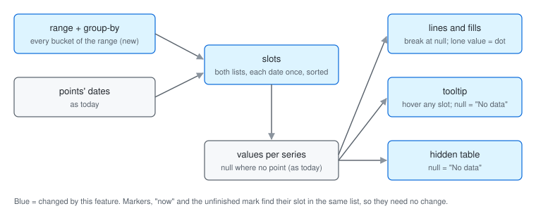

# Architecture: Empty periods in the time series chart

When the chart has a `range`, its list of slots (the x-axis dates) is every bucket of that range plus any other date a point has. A series with no point in a slot already gets `null` there; the drawing, tooltip and hidden table now treat that `null` as "no data" instead of bridging or hiding it.



## Decisions

- **Fill from `range`, not a new value type.** `UauiPoint.value` stays `number` (BRIEF, Not doing).
- **The slots are built in `buildChartData`**, which already owns the shared date list. The element passes `range.to` beside `range.from` in the anchors it already sends. No new public names.
- **Buckets come from the internal `dateBuckets`**, the same code behind the public `uauiBucketsFor`, so a product that builds its points from `uauiBucketsFor` gets exactly the same slots.
- **Bucket starts go through the chart's own `keyOf`**, the same as points. At hour level that turns each start into the UTC instant of its local hour, so a clock-change day's 23 or 25 hours match the points' keys one for one. This closes the brief's hour-level unknown.
- **A point is not moved to the start of its bucket.** A week point dated mid-week keeps its own slot beside the week's slot, as today. Snapping would add points up per bucket, which quietly adds up rates.
- **Lines use `spanGaps: false`** for series and compare lines, as the share view already does. Every line breaks at a missing value, including a series that's just sparser than the others; there's no setting to keep bridging.
- **A value with an empty slot on both sides gets a dot**, even when the chart has turned dots off (over 45 slots, or a line with a compare line). Without one, a lone value draws nothing.
- **Hover follows the x-axis.** The tooltip handler takes the slot under the mouse from the x scale, not the nearest drawn point: Chart.js skips empty points when it looks for the nearest one, so an empty slot could never be hovered. The tooltip sits at the top of the plot there, since there's no point to sit above.
- **Markers, "now" and the unfinished mark don't change.** They already look up their slot in the date list, so a fuller list puts a marker on an empty day instead of dropping it.
- **Compare points now land on empty days.** Today a compare point whose day has no current point is dropped; with the slot there, it shows.
- **No cap on slots.** A sparse hourly year makes 8,760 slots, the same as dense hourly data does today.

## What changes

**Client** (`src/Umbraco.Analytics.UI/Client/src`)

```text
chart/
  time-series-chart.element.ts   passes range.to; tooltip rows for missing values
  internal/
    chart-data.ts                slots = range buckets + point dates (when range has from and to)
    chart-renderer.ts            spanGaps false; dot on a lone value; hover slot from x position
    chart-tooltip.element.ts     a row with no value shows "No data"
    chart-data-table.element.ts  an empty cell says "No data"
lang/en.ts                       new key uauiAnalytics_chartNoData
examples/pages/commerce/
  commerce-analytics-page.test.ts   checks the rate chart's gaps before the store opened
```

- **Public API:** none. `api/analytics-ui.api.md` must not change.
- **Changelog:** a `### Changed` line (SPEC, R10).
- **Isolation:** no new Chart.js plugin or global setting; `time-series-chart.isolation.test.ts` still guards that.

Not touched: `uaui-category-chart`'s slots (they are its `categories`); it shares the hidden table, so its empty cells also read "No data", but its tooltip still leaves out a series with no value (a follow-up), `UauiPoint` (no `null`), the date helpers (used as they are), the KPI tile's "No data for this period" (its own key).
