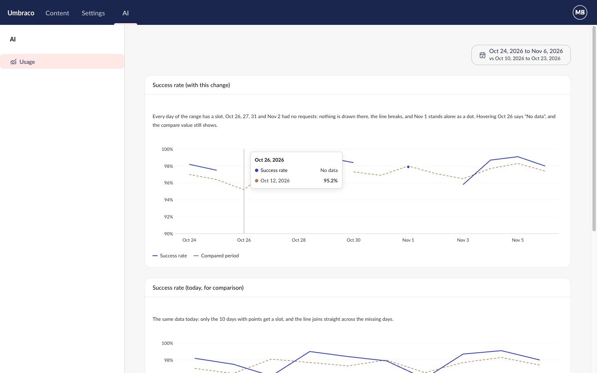

# Spec: Empty periods in the time series chart

## Endpoints
None. The package has no API.

## Rules

- **R1** With `range` set, the x-axis has one slot per bucket of `range` at the chart's `group-by` (and `week-start`), the same buckets `uauiBucketsFor(range, groupBy, { weekStart })` returns.
- **R2** A point whose date isn't one of those buckets still gets a slot, in date order. Nothing a product passes is dropped.
- **R3** With no `range`, the slots are the points' dates, as today.
- **R4** At hour level, a day the clocks go forward has 23 slots and a day they go back has 25. A point in either 2 AM of the repeated hour lands in the first, as today.
- **R5** A line, its area fill and its compare line draw nothing in an empty slot and don't join across it. A bar is simply absent.
- **R6** A value with an empty slot (or the chart's edge) on both sides shows as a dot, whether or not the chart shows dots.
- **R7** Any slot can be hovered, empty or not. The tooltip's heading is the slot's date; each shown series has a row, and one with no value reads "No data" with no compare change. A compare value at that slot still shows.
- **R8** The tooltip's total row is left out when every series is empty there, as today.
- **R9** In the hidden table, every empty value cell reads "No data", compare cells included, never a blank and never 0. The tooltip and table share one new key, `uauiAnalytics_chartNoData` ("No data").
- **R10** `CHANGELOG.md` gets a `### Changed` line: `uaui-time-series-chart` fills its x-axis with every period of `range`, and lines break where a period has no point; send 0 for counts.
- **R11** A marker, the "now" line and the unfinished-period mark in an empty slot show there. Markers outside every slot are still dropped.
- **R12** A compare point whose matching current slot is empty now shows there, instead of being dropped.
- **R13** The example pages need no data change: Commerce and Forms already leave a rate out on a day with nothing to divide by. With `range` already passed, their charts now show every day of it.
- **R14** No change to the public API report. No global Chart.js setting or plugin.

## Time series chart

Any chart with `range`. The mockup uses a success rate chart over 14 days.

[Mockup source](./mockups/empty-periods-chart.html)

| When | The chart |
|---|---|
| A slot has no point | Draws nothing there; the line breaks |
| A value stands alone | Draws a dot |
| Hover an empty slot | Tooltip: date, "No data" per series, compare value if any |
| Every slot is empty | The chart's own empty state, as today (no points at all) |
| Dark mode | Same, with the dark tokens; nothing new is coloured |

- First run, mistake, wait, finish and return: no change. Loading and error states are the chart's existing ones.
- The hidden table (lower box in the mockup) is how screen reader users read the gaps.

## Targets

- Axe passes on a chart with empty slots, in light and dark mode.
- A 30-day range at day level with 5 points draws in the same test time budget as today's 30-point chart (no new per-slot work beyond the bucket list).
- `npm run check:size` stays under its limit.
