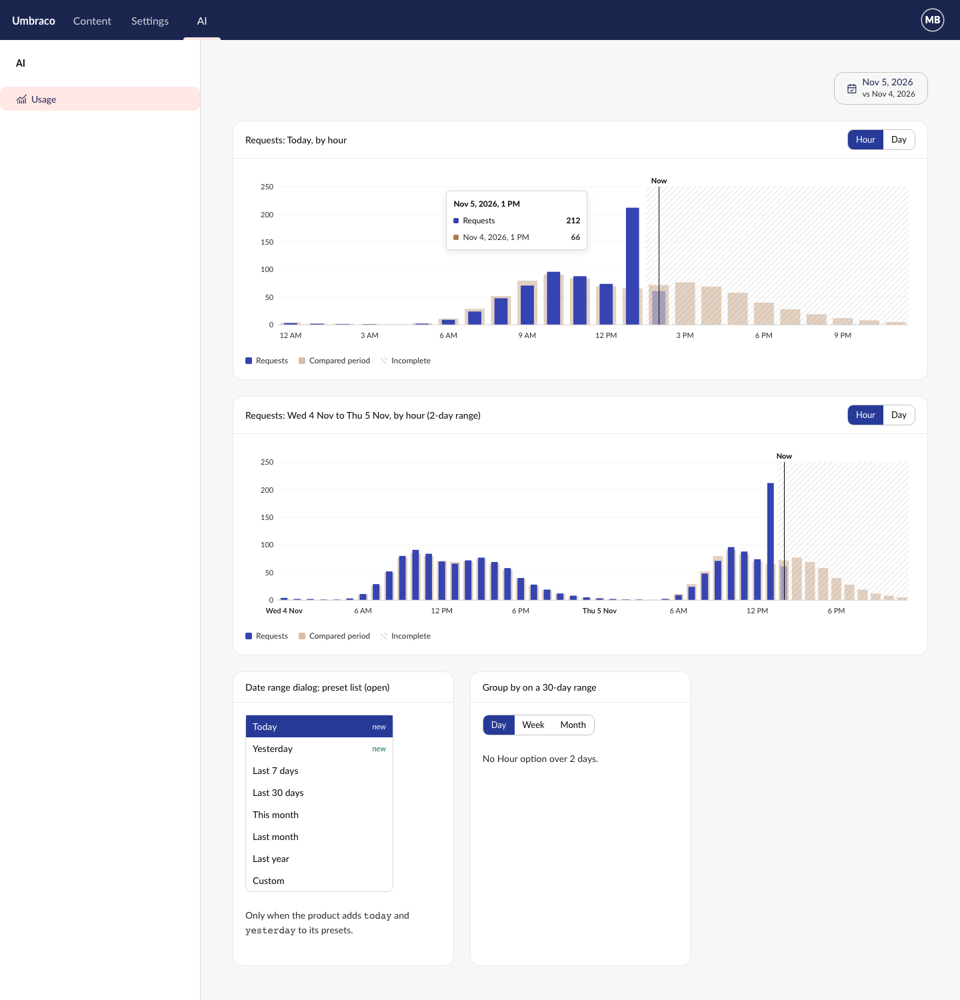

# Spec: Hourly buckets

## Endpoints
None. This package draws only.

## Rules

**Hourly points**
- **R1** With `group-by="hour"`, each point's `date` is a moment: `"2026-11-05T13:00:00Z"`, `"2026-11-05T14:00:00+01:00"`, or `"2026-11-05T14:00"` (no offset, read as local time). A plain date (`"2026-11-05"`) is local midnight.
- **R2** Each point goes in the local hour that contains it. Points in the same hour add up, so `14:00` and `14:30` make one bar.
- **R3** The chart's dates are its points' dates, as today: a product passes a point (0 when there's nothing) for every hour it wants drawn, including hours still to come.
- **R4** On the day clocks go forward, a day has 23 bars. On the day they go back, it has 25.
- **R5** The chart draws hourly for any range length. Only `uauiGroupByOptions` holds the 2-day limit.
- **R6** With `group-by` day, week or month, nothing changes: a date-time point is still cut to the day it starts with.

**Compare**
- **R7** A compare point lines up by wall-clock hour from the start of its range: hour 14 of the compare range's first day sits under hour 14 of the current range's first day.
- **R8** On the day clocks go back, both compare points in the repeated hour add up into one value.
- **R9** The tooltip names the compare point's own date and hour ("Nov 4, 2026, 1 PM").

**`now`**
- **R10** `now` replaces `today` on `uaui-time-series-chart` (attribute `now`). `today` is removed.
- **R11** `now` and `incomplete-from` are moments: a date-time with `Z` or an offset is turned into the browser's local time first, at every `group-by`. A date is that local day. (Points at day, week and month are still cut to the day, R6.)
- **R12** The line is drawn in the middle of the bucket that contains `now` (its hour, day, week or month), not at the exact minute. Nothing is drawn when no bucket contains it.
- **R13** The label over the line is "Today" at day, week and month, and "Now" at hour.
- **R14** The tooltip and the hidden table name the bucket: "2 PM (now)", "2 PM (now, incomplete)" at hour level. Day, week and month keep their current wording.

**`incomplete-from`**
- **R15** At hour level, everything from the hour that contains `incomplete-from` onward is incomplete. A plain date means from midnight.

**Group by**
- **R16** `UauiGroupBy` is `"hour" | "day" | "week" | "month"`. `uaui-group-by` labels it "Hour".
- **R17** `uaui-group-by`'s default `options` stay day, week and month.
- **R18** `uauiGroupByOptions(range)` returns hour and day for a range of 2 days or less, and day, week and month otherwise, or when the range isn't valid.
- **R19** When the range changes and the chosen option isn't in the new list, the product switches to the list's first option. The control doesn't do it, since it doesn't know the range.

**Buckets helper**
- **R20** `uauiTimeBuckets(range, "hour")` (renamed from `uauiDateBuckets`) returns one bucket per local hour from the range's first midnight to the midnight after its last day. `start` is the hour's start as a UTC instant (`"2026-11-05T13:00:00.000Z"`), `end` the next hour's start, and `days` the one local date it's in.
- **R21** Every bucket, at every unit, has `end`: the first day after it for day, week and month (`"2026-11-06"`), the next instant for hour.

**Presets**
- **R22** `today` and `yesterday` are built-in preset ids, labelled "Today" and "Yesterday". Each is a one-day range.
- **R23** They are not in the default preset list. A product adds them: `presets: [{ id: "today" }, { id: "yesterday" }, …]`.
- **R24** `uauiPresetRange("today", today)` and `("yesterday", today)` give their dates, as for the other built-ins.
- **R25** "Previous period" for today is yesterday; for yesterday, the day before.

**Text**
- **R26** Hour labels and tooltips are formatted with `Intl` in the backoffice user's culture: "2 PM" in en-US, "14" in da-DK.
- **R27** New keys in `lang/en.ts`: `groupByHour` "Hour", `chartNow` "Now", `chartNowDate` "{0} (now)", `chartNowIncompleteDate` "{0} (now, incomplete)", `dateRangeToday` "Today", `dateRangeYesterday` "Yesterday".
- **R28** Axis labels at hour level: one every 3 hours on a one-day range, every 6 on two days. The first hour of each day shows the date instead ("Thu 5 Nov"), in bold.
- **R29** On the day clocks go back, the repeated hour is labelled twice on the axis, and its two tooltips add the zone name ("2 AM CEST", "2 AM CET").
- **R30** A one-day range shows one date on the date range button and from `uauiFormatDateRange` ("Nov 5, 2026").

## Hourly chart
A product's chart box with `group-by="hour"`, opened on the "Today" preset.

[Mockup source](./mockups/hourly-chart.html)

| When | The chart |
|---|---|
| Today, at 2:23 PM | 24 bars. Now line in the 2 PM bar; 2 PM onward faded and hatched |
| Yesterday | 24 bars, no now line, no hatching |
| Two days | 48 bars; each day's first label is its date |
| A 30-day range | The product offers Day, Week, Month only |
| Hover a bar | Tooltip: "Nov 5, 2026, 1 PM", each series, and the compare hour |
| Loading, empty, error | As the chart does today, no change |

The mockup's charts are hand-drawn SVG. The built chart uses the existing bar, compare and hatching looks; only the axis labels and the line's word are new.

## Targets
- **Accessibility:** the hidden data table lists every hour with its full date and hour ("Nov 5, 2026, 2 PM (now)"), and the chart passes `axeRun` at hour level.
- **Clock changes:** tests pin the time zone to `Europe/Copenhagen` and cover 29-03-2026 (23 hours) and 25-10-2026 (25 hours).
- **No change for day, week, month:** the existing chart, group-by and date-helper tests pass with only `today` renamed to `now`.
