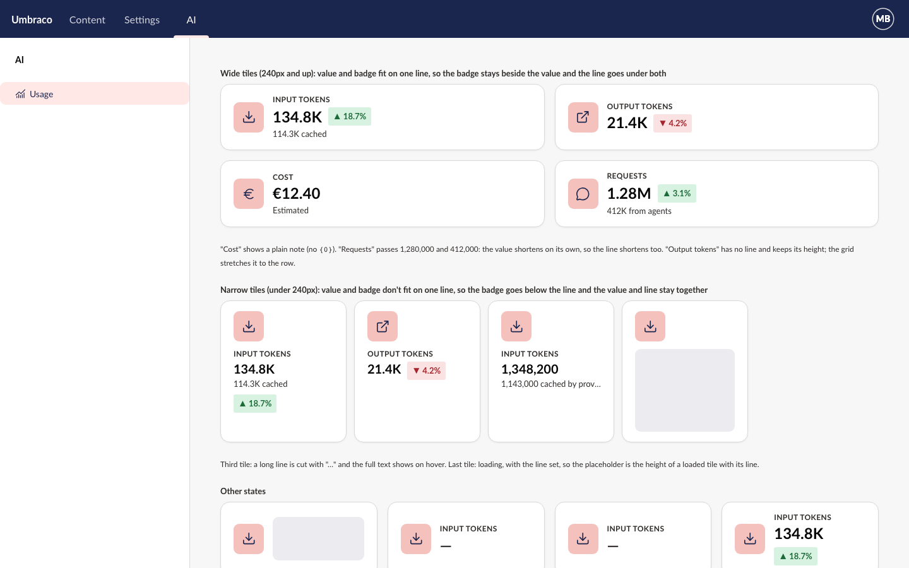

# Spec: KPI tile second line

## Element: `uaui-kpi-tile`

New properties. All three are public API.

```ts
detail?: string;                        // attr "detail": "{0} cached", or a plain note
detailValue?: number;                   // attr "detail-value": 114300
detailFormat?: Intl.NumberFormatOptions; // attr "detail-format"; defaults to valueFormat
```



[Mockup source](./mockups/kpi-tile.html)

## Rules
- **R0** The line is 13px, normal weight, in the label's grey (`--uui-color-text-alt`).
- **R1** With `detail` "{0} cached" and `detail-value` 114300, the tile shows a line under the value reading the number formatted in the editor's language, then " cached".
- **R2** The number uses `detail-format`, or `valueFormat` when `detail-format` is unset.
- **R3** When the value is shown short (by the 1,000,000 rule) and `detail-format` doesn't set `notation`, the line's number is shown short too, even under 1,000,000.
- **R4** The line's own number shortens by the 1,000,000 rule, as the value does, unless its format sets `notation`.
- **R5** A short number on the line has its exact amount as its hover title and as the text screen readers read, as the value does.
- **R6** Every `{0}` in `detail` is filled. Other placeholders, such as `{1}` or `%0%`, stay as typed.
- **R7** A `detail` with no `{0}` is shown as given, with or without `detail-value`.
- **R8** A `detail` with `{0}` and no finite `detail-value` shows no line.
- **R9** No `detail`, or an empty one, shows no line, whatever `detail-value` is.
- **R10** With `error` or `no-data`, no line is shown.
- **R11** The line is inside the tile's content. Screen readers read the value, then the line, then the badge, so the value and its part stay together. It is part of a link's or button's name.
- **R12** When the value and the badge fit on one line, the badge sits beside the value and the line goes under both. When they don't, the value, the line and the badge stack in that order, so the badge never comes between the value and the line. Which one applies follows the real rendered widths of the value, badge and row, never a fixed breakpoint: at the same tile width, a short value keeps the badge beside it and a long one doesn't. It updates as the tile resizes or the value changes. Tiles without a line keep today's badge layout.
- **R13** While loading with no value, the skeleton is the height of a loaded tile with its line when `detail` is set, and today's height when it isn't, on wide and narrow tiles.
- **R14** While loading with a value, the line stays.
- **R15** A tile with no `detail` renders exactly as today, the same height.
- **R16** Text in `detail` is shown as text, never as HTML.
- **R17** A line too long for the tile is cut with "…", with the full text as its hover title.

## Targets
- The line passes 4.5:1 contrast on the tile surface in light, dark and high contrast. `--uui-color-text-alt` is already checked for the label.
- axe passes on every new story state.
